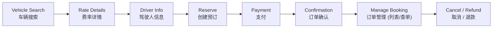

# TrustGo 官方网站

> **Go Easy. Go Happy.** — 轻松出发，快乐同行

TrustGo 是面向全球 car rental（租车）业务的自营品牌官方网站，IX RENTAL 的姊妹品牌。网站面向国际自驾旅行客户提供从了解品牌、搜索车辆、在线预订到订单查询的自助服务，同时为中小型车行提供加盟 TrustGo 品牌的合作入口。

## 品牌与定位

TrustGo 的核心使命是**让国际自驾旅行更轻松、更安心、更有温度**。

| 维度 | 内容 |
| --- | --- |
| Brand Personality | Warm · Friendly · Easygoing · Trustworthy |
| Easy Booking | 简单清晰的预订体验 — 从搜索到下单三步完成 |
| Travel with Confidence | 清楚了解租车规则和保障 — 价格透明、政策可读 |
| Freedom to Explore | 按自己的节奏探索目的地 — 灵活取还、丰富车型 |

官网是 TrustGo 面向 TOC 客户的品牌渠道。FleetEdge（FE）商户端通过 OpenAPI 同时服务官网和 Trip.com、Booking.com、Carmore 等 OTA；对 FE 而言，官网也是一个渠道。官网负责品牌内容、客户界面和渠道体验，租车基础信息与预订核心逻辑由 FE 提供。

## 业务能力

### C 端个人租车

- **用户账号与双轨预订**：
  - **用户注册与登录（User Account / Auth）**：主动注册设置密码后登录；已有密码账户使用邮箱与密码登录，首次设密和忘记密码通过邮箱验证码验证；账户中心维护个人资料、常用旅客与联系方式。
  - **Guest booking / 访客预订**：无需注册即可完成预订；驾驶人页可选择使用预订联系邮箱建账，支付确认后处理，建账失败不影响支付。订后凭预订确认号（Confirmation Code）+ 驾驶人姓氏（Driver Last Name / Surname）查单；建账本身不建立会话、不自动关联所有历史订单。
- **在线预订**：按取还地点（Pick-up / Drop-off Location）、日期时间、驾照地区和驾驶人年龄搜索可用车辆（Vehicle Availability Search），查看费率详情（Rate Rules）、取还方式和取消政策（Cancellation Policy）后确认预订（Create Reservation）。
- **在线支付**：在确认下单流程中展示费用明细（Total Charge、Extra Charges）并承接支付结果。
- **订单管理（订单列表与订单详情）**：
  - **我的订单列表（My Bookings）**：注册用户登录后集中查看全部订单状态卡片（进行中 / 已完成 / 已取消），支持状态筛选与快速核对。
  - **访客查单（Find Reservation）**：提供无需登录的订单验证入口，凭预订确认号与驾驶人姓氏（Confirmation Code + Last Name）检索单个订单。
  - **订单详情（Booking Details）**：展示行程凭证、车辆与网点信息、支付与履约状态、规则快照、Online Check-in 预审入口与取消 / 退款申请。
- **取消与退款申请**：在订单详情中查看取消政策（含免费取消期限 Free Cancellation Deadline 和罚金），并按订单状态提交取消 / 退款申请。
- **Online Check-in / 在线身份核验**：面向支持的取车场景提供证件预审能力；正式的驾驶证、护照或其他身份文件审核仍需后端服务、隐私授权和运营流程共同支撑。

### 品牌与合作

- **品牌宣传**：介绍 TrustGo 的品牌定位、服务标准、价格透明、取还灵活和多语言支持能力。
- **门店与服务网络**：展示机场、市区、酒店及自助取还网点（Location / Depot）的地点、联系方式、营业时间和取还说明。
- **加盟合作**：面向中小型车行展示 TrustGo 的品牌运营、系统、渠道和培训服务，并通过服务端线索 API 承接合作咨询。

## 预订主流程



| 步骤 | 用户操作 | 系统交互 |
| --- | --- | --- |
| 车辆搜索 | 输入取还地点、日期、驾驶人年龄 | FE `vehAvailRate` → 返回可用车辆、费率和供应商 |
| 费率详情 | 选择车辆，查看完整价格、政策和附加服务 | FE `vehRateRule` → 取消政策、押金规则、保险套餐、燃油和里程政策 |
| 驾驶人信息 | 登录用户自动填充 / 访客手动填写姓名、联系方式、驾照地区、航班信息，选择附加设备（Special Equipment） | 前端表单校验；数据暂存为预订草稿 |
| 创建预订 | 确认订单摘要（车辆 + 费率 + 驾驶人 + 政策），提交预订 | FE `vehRes` → 返回预订确认号（Confirmation Code） |
| 支付 | 完成在线支付 | Payment 模块 → Stripe |
| 订单管理 | 登录用户在订单列表中查看行程；访客通过确认号+驾驶人姓氏（Last Name）查单；核对预订信息（暂不支持在线修改，如需变更行程需取消后重新预订） | FE `vehResStatusSearch` |
| 取消 / 退款 | 提交取消申请 | FE `vehCancel` → 返回取消费用和退款金额 |

## 系统边界

TrustGo 官网通过 **OpenAPI** 对接 **FleetEdge（FE）商户端系统**。FE 管理租车业务基础信息和预订核心逻辑，服务多个销售渠道：

- **门店网点配置**：网点基础信息、地理围栏、营业时间、取还车说明（Location / Depot）；
- **车辆库存与可用性**：车型组（Vehicle Category）、配额控制、可用车辆搜索（Vehicle Availability Search / `vehAvailRate`）；
- **费率与报价策略**：基础费率（Rental Rate）、总价计算（Total Charge）、附加费用（Extra Charges）与费率规则详情（Rate Rules / `vehRateRule`）；
- **保障与服务政策**：取消规则（Cancellation Policy）、押金规则（Deposit）、保险套餐（Insurance Package）及燃油/里程政策；
- **预订生命周期处理**：创建预订（Reserve / `vehRes`）、状态查询（Status Query / `vehResStatusSearch`）及取消/退款处理（Cancel / `vehCancel`）。

官网通过自己的服务端 OpenAPI 适配层连接 FE，负责将 FE 能力呈现给客户并提供官网渠道专属体验；不复制 FE 的基础信息和预订核心规则。官网与 FE 均由 IX 团队开发，允许按业务需要协同定制，但以 OpenAPI 契约划分职责。浏览器不直连数据库。

## 功能模块

| 模块 | 主要能力 | 路由 | 状态 |
| --- | --- | --- | --- |
| 品牌首页 | 沉浸式 Hero（自驾摄影 + 核心搜索栏）、三大品牌承诺（Easy Booking / Travel with Confidence / Freedom to Explore）、精选自驾灵感 | `/{lang}/` | 已实现 |
| 门店网络 | 门店列表与地图（按城市 / 交通枢纽索引） | `/{lang}/locations` | 已实现 |
| 门店网络 | 门店详情（营业时间、取还车指引、联系方式） | `/{lang}/locations/{slug}` | 规划中 |
| 在线预订 | 车辆可用性搜索结果与筛选 | `/{lang}/rent` | 已实现 |
| 在线预订 | 车辆费率详情（保险套餐、附加设备、取消政策、取车指引） | `/{lang}/rent/{id}` | 已实现 |
| 在线预订 | 驾驶人信息录入 | `/{lang}/book/driver` | 已实现 |
| 在线预订 | 预订预占与支付 | `/{lang}/checkout`、`/{lang}/checkout/{reservationId}` | 已实现 |
| 订单管理 | 访客凭确认号 + 驾驶人姓氏查单 | `/{lang}/manage-booking` | 已实现 |
| 订单管理 | 订单详情、Online Check-in 入口、取消 / 退款申请 | `/{lang}/booking/{confirmationCode}` | 已实现 |
| 订单管理 | 我的订单列表（已登录用户） | `/{lang}/bookings` | 规划中 |
| 用户中心 | 会员注册与登录、找回密码、个人资料、常用驾驶人 | `/{lang}/auth/*`、`/{lang}/account/*` | 规划中 |
| 品牌与内容 | 品牌理念、帮助中心、自助取还车指引、条款与隐私 | `/{lang}/{slug}`（`about`、`help`、`self-service`、`terms`、`privacy`、`cookies`、`safety`） | 已实现 |
| 加盟合作 | 中小型车行加盟合作咨询 | `/{lang}/franchise` | 已实现 |

`{lang}` 支持 `en`、`zh`、`ja`、`es`、`ko`，分别对应英文、繁体中文、日文、西班牙文和韩文。

## 国际化

项目从路由、页面 metadata、结构化数据到交互文案统一考虑 i18n：

- 语言与路由定义集中在 `src/i18n/locales.ts`；
- 每个业务模块拥有自己的页面、表单、错误、空状态和无障碍文案；
- 支持 canonical、`hreflang`、Open Graph、HTML `lang`、robots 和多语言 sitemap；
- 新增或变更文案必须同步检查五种语言及明确的 fallback 行为；
- 日期、时间、时区、金额、币种、距离和租车术语必须按 locale 与业务事实本地化。

## 设计系统

TrustGo 品牌设计规范详见 [`docs/guides/`](docs/guides/)，视觉风格对齐 Airbnb 的克制、照片优先与留白分组：

| 规范 | 核心内容 |
| --- | --- |
| [Design Tokens](docs/guides/design-tokens.md) | 品牌色 `#25A5E3` / 辅助色 `#FF7F50` 与派生色、中性色与反馈色、多语言字体栈、字号阶梯、间距、5 级圆角（卡片 12px）、阴影与层级、Tailwind `@theme` 映射 |
| [Design Guidelines](docs/guides/design-guidelines.md) | 设计原则、摄影、UX 文案、交互与动效、弹层选择（PC Popover / Modal，H5 Sheet）、信息降维、页面状态、评审清单 |
| [Component Library](docs/guides/component-library.md) | 按钮 / 输入 / Chip / Badge → 搜索栏 / 价格块 / 弹层家族 → 车辆卡片 / 吸顶价格卡 / 吸底操作栏 / 订单状态头 |
| [Layout & Grid](docs/guides/layout-grid.md) | 三级断点、4 / 8 / 12 列栅格、容器宽度、垂直节奏、吸顶 / 吸底、安全区域、触控与溢出 |
| [Page Patterns](docs/guides/page-patterns.md) | 首页、门店、搜索结果、费率详情、下单、查单与订单详情的 PC / H5 页面模式 |

## 本地开发

使用当前 Node.js LTS、npm 和 Python 3（本地预览管理脚本）：

```bash
npm install
npm run dev
```

默认开发地址为 `http://localhost:4000`。打开 `http://localhost:4000/en/` 查看英文首页，也可以访问 `/zh/`、`/ja/`、`/es/` 或 `/ko/`。

```bash
npm run dev          # 前台开发（4000）；已有健康服务时复用；本次新启动的服务由 Ctrl+C 停止
npm run preview      # 后台预览，可重复运行，终端退出后继续提供服务
npm run preview:status  # 检查端口归属与首页 HTTP 响应
npm run preview:restart # 停止本项目的开发服务后重新启动
npm run preview:stop # 停止本项目的开发服务，释放 4000
npm run build        # 类型检查并生成生产构建
npm run start        # 启动生产构建（端口 4000）
npm run check:i18n   # 检查各语言文案 key 是否齐全、引用的 key 是否存在
npm run check:build  # 构建后检查最终 HTML 的文档结构、语言与本地字体
npm run test:site-navigation # 换语言保留行程、离开确认及预订联系邮箱回归
npm run test:customer-account # 账户、验证码、会话及结算建账业务回归（隔离进程，无网络）
npm run test:rental-business  # 租车预订、支付、取消与访问权限回归
```

开发服务使用 `.next-dev/`，生产构建使用 `.next/`。重复运行启动命令不会另起第二个服务；4000 被其他项目或生产服务占用时会明确报错并保留该进程。后台预览不会被其他终端的 `Ctrl+C` 停止，需使用 `npm run preview:stop`。日志位于 `.local-preview/server-4000.log`。

若日志明确显示组件清单或缓存异常，可运行 `npm run preview:restart -- --clean-cache`；它只备份开发缓存后重启，不清理源码、环境变量或生产构建。源码报错和字体下载失败仍需按日志处理。Agent 不应绕过入口直接启动 `next dev`。进程生命周期回归可运行 `python3 scripts/test-preview.py`；页面点击验收仍交由人完成。

账户当前使用仅限开发 / 测试的进程内适配器，重启会清空账户、会话和验证码；验证码通过本地验证响应辅助验收，通知事件标记为 `preview_only`，不代表真实邮件投递。生产环境账户接口返回 `503 SERVICE_UNAVAILABLE`（退出仍可清理 Cookie），不会把内存注册或未投递邮件报告为生产成功。真实账户服务须补齐共享持久化、事务、限流与邮件投递，并提供相同业务接口；不能通过关闭这一保护代替对接。

页面点击验收仍交由人完成；交付验证要求见 [`AGENTS.md`](AGENTS.md) 的“交付验证”一节。

## 项目架构

以下目录是 TrustGo 官网的架构基线，新增和迁移代码都遵循该结构。标注"规划中"的目录在对应能力落地时创建，不提前建空目录。

```text
src/
├── app/                              # Next.js App Router：仅负责路由、metadata、结构化数据与模块挂载
│   ├── [lang]/
│   │   ├── layout.tsx                # 语言根文档与外壳（Header / Footer / html lang）
│   │   ├── page.tsx                  # 品牌首页
│   │   ├── rent/                     # 搜索结果；rent/[id] 为车辆费率详情
│   │   ├── book/driver/              # 驾驶人信息
│   │   ├── checkout/                 # 预订预占与支付；checkout/[reservationId]
│   │   ├── booking/[confirmationCode]/ # 订单详情
│   │   ├── manage-booking/           # 访客查单
│   │   ├── locations/                # 门店列表
│   │   ├── franchise/                # 加盟合作
│   │   └── [slug]/                   # about、help、self-service、terms、privacy 等内容页
│   ├── api/                          # Route Handlers（规划中，仅放必要的服务端入口）
│   ├── (entry)/                      # 无语言前缀入口的根文档与重定向
│   ├── global-not-found.tsx          # 未匹配路由的独立 404 文档
│   ├── globals.css                   # Tailwind 入口与 Design Tokens（@theme）
│   ├── robots.ts
│   └── sitemap.ts
├── modules/                          # 按业务事实和能力纵向划分
│   ├── home/                         # 首页品牌内容模块
│   ├── destination-search/           # 取还车地点 / POI 搜索
│   ├── rental-search/                # 车辆可用性搜索、筛选、结果展示
│   ├── rate-details/                 # 费率详情：保险套餐、附加设备、取消政策、取车指引
│   ├── reservation/                  # 驾驶人信息、预订草稿与创建预订
│   ├── checkout/                     # 预订预占与支付流程编排
│   ├── booking-management/           # 访客查单、订单详情、取消和退款进度
│   ├── identity-verification/        # Online Check-in，独立于取车模式
│   ├── payment/                      # 规划中：独立支付领域，Stripe 是 provider
│   ├── auth/ · account/              # 规划中：会员认证、个人中心、常用驾驶人
│   └── locations/ · franchise/       # 规划中：门店详情、加盟线索
├── integrations/                     # 规划中：外部系统协议、client 和 DTO 映射
│   └── fleetedge/                    # client.ts / contracts.ts / mappers.ts
├── shared/ui/                        # 基于 shadcn/ui 原语的通用组件（Button、Card、Dialog、Sheet…）
├── i18n/                             # 语言与路由定义（locales.ts）、各语言文案目录
├── components/                       # 遗留目录：不再新增文件，修改时迁移到模块 ui/ 或 shared/ui/
├── lib/
└── assets/

public/                               # 可公开访问的静态资源
docs/
├── apis/                             # OTA 渠道 API 文档（Trip.com / Booking.com / Carmore）
├── guides/                           # TrustGo 设计规范（Tokens / Guidelines / Components / Layout / Page Patterns）
└── template/                         # PRD / SPEC 需求文档模板
specs/                                # 可实施、可验收的需求规格
scripts/                              # 架构、质量和构建检查脚本
```

### 模块内部结构

语言路由的根文档直接使用 `[lang]` 参数输出 HTML 语言，公共文档结构由 `shared/ui/site-document.tsx` 复用；未匹配路径使用 Next.js 15 的 `experimental.globalNotFound` 独立输出 404，已匹配语言路由内的资源缺失使用该语言的 `not-found.tsx`。Poppins 的四个字重从 npm 依赖读取本地 WOFF2 文件，构建不访问 Google Fonts。

业务模块按实际复杂度使用下列目录，不为简单模块创建空目录：

- `domain/`：领域实体、状态、值对象和纯业务规则；
- `application/`：用例编排，不包含 provider SDK 或 React UI；
- `api/`：调用 Route Handler 或独立后端 API 的 client；
- `ui/`：页面组件、业务组件和 hooks；
- `i18n/`：该模块的五语言文案；
- `mock/`：仅用于本地开发和验收的可复现数据；
- `public-api.ts`：模块唯一公开入口。

### 依赖规则

- `src/app/` 路由只负责参数、metadata、结构化数据和模块挂载，不实现业务规则；
- 业务模块拥有自己的 UI、领域类型、规则、i18n 和 mock；
- 模块之间只能依赖对方的 `public-api.ts`，禁止跨模块深层导入；
- `integrations/` 隔离 FleetEdge 等外部协议，领域模块不直接依赖外部 DTO；
- `shared/` 只接收没有明确业务所有权的复用能力，不得成为全局业务杂物目录；
- 基础 UI 控件统一基于 shadcn/ui 原语和 Tailwind CSS 4 构建，直接消费 [Design Tokens](docs/guides/design-tokens.md)；
- Online Check-in 属于 `identity-verification`，不能因为自助取车依赖它就归入 `self-service`；
- 新增或修改的手写代码文件必须严格少于 2000 个物理行，达到阈值前必须按职责拆分。

## Payment

Payment 是独立业务模块，统一拥有支付会话、支付尝试、支付状态和失败恢复；Stripe 只是 provider。Checkout、Reservation 和 Booking Management 只能通过 Payment 的公共接口使用支付能力，不得各自维护支付状态机。

浏览器不得保存完整卡号、CVC、secret key 或完整支付 token，也不得通过支付回跳 URL 判定支付成功。支付时序、前后端职责、Stripe 接入、Webhook、幂等、异常补偿、退款与验收要求将在 `specs/payment/` 中定义。

## 能力优先级

| 能力 | 优先级 | 实现复杂度 | 说明 |
| --- | --- | --- | --- |
| 核心预订链路：车辆搜索 → 费率详情 → 驾驶人信息 → 创建预订 → 支付 | P0 | 高 | 依赖 FE `vehAvailRate` / `vehRateRule` / `vehRes` 与支付 provider |
| 订单详情、访客查单、取消预订 | P0 | 中 | 依赖 FE `vehResStatusSearch` / `vehCancel` |
| Online Check-in 证件预审 | P1 | 高 | 依赖合规的证件上传、加密存储与过期清理 |
| 会员账号、我的订单列表、常用驾驶人 | P1 | 中 | 依赖认证服务与访客订单归档 |
| 门店详情、加盟线索 | P2 | 低 | 以 FE 门店数据与服务端线索 API 为准 |

## 生产就绪标准 (Production Readiness)

本项目处于工程规范建立阶段。在正式交付投产前，各业务模块必须满足以下生产就绪标准：

- **FleetEdge 契约闭环**：完成 FE OpenAPI 真实环境接入（API 认证、网点、车辆库存与可用性搜索、费率计算、预订创建及履约状态流转）；
- **支付与交易安全**：完成 Stripe 支付会话、Webhook 异步对账、重试幂等及退款状态机闭环；
- **身份核验合规**：Online Check-in 具备合规的证件上传通道、临时存储加密与访问过期清理机制；
- **全端体验与 SEO**：满足 Core Web Vitals（LCP/CLS/INP）性能基准，通过 Desktop / Tablet / Mobile 响应式栅格与 5 语言 SEO 元数据验证；
- **数据与安全基线**：严禁在前端持久化或 URL 中暴露卡号、CVC、真实令牌或未经脱敏的敏感个人信息。详细需求和接口协议见 [`docs/`](./docs/) 与 [`specs/`](./specs/)。
