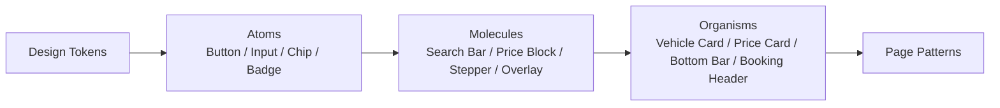

# TrustGo Component Library：UI 组件说明

本文件定义构成 TrustGo 体验的核心组件结构与行为。所有组件只消费 [Design Tokens](design-tokens.md)；基础交互组件基于项目内 shadcn/ui 原语（Radix）与 Tailwind CSS 4 构建，放在 `src/shared/ui/`；业务组件放在所属模块的 `ui/` 目录并通过 `public-api.ts` 暴露。



## 1. 基础组件（Atoms）

### 1.1 按钮（Button）

| 变体 | 样式 | 用途 |
| --- | --- | --- |
| Primary | `Primary-Strong` 填充、白字、`Radius/sm` | 每个视口唯一主操作："Search cars"、"Continue"、"Pay now" |
| Secondary | 白底、1px `Border/Default`、`Text/Primary` 文字 | 次要操作："Filters"、"View details"、"Change dates" |
| Ghost | 无底无边，Hover 显示 `Background/Muted` | 工具栏、弹层内次要操作 |
| Text | 无底，`Primary-Strong` 文字，Hover 下划线 | 段落内链接、"Show all" |
| Text action (`text`) | 默认中性文字，Hover 为 `Primary-Strong` 文字 + 下划线；Pressed 为 `Primary-Strong` 文字 + `Primary-Light` 浅底 | 重置筛选、列表“查看详情”等轻量文字操作；保留标准 Focus Ring 和触控区域 |
| Destructive | 白底、1px `Border/Default`、Error 色文字 | 取消预订；确认弹层中可升级为 Error 填充 |

| 尺寸 | 高度 | 字号 / 字重 | 用途 |
| --- | --- | --- | --- |
| `lg` | 48px | 16px / 600 | 默认尺寸；H5 所有主按钮；吸底栏按钮 |
| `md` | 40px | 14px / 600 | PC 卡片内、表单辅助操作 |
| `sm` | 32px | 14px / 500 | 仅 PC 工具栏；命中区域须扩展到 44px |
| `icon` | 40 × 40px 圆形 | — | 关闭、返回、收藏；命中区域 44px |

- H5 上的主按钮在吸底栏和表单底部占满容器宽度；PC 上按内容宽度，最小宽 120px。
- 提交中显示行内 Spinner，保持宽度不变；禁用态使用 `Text/Disabled` 文字与 `Background/Subtle` 底色，不使用整体 50% 透明度。

### 1.2 输入框（Input）

采用 Airbnb 式**浮动标签**输入框：Label 在框内，未输入时居中显示，聚焦或有值后上移为 12px 小字。

| 属性 | 规范 |
| --- | --- |
| 高度 | 56px（`Size/Control-lg`） |
| 圆角 | `Radius/sm`（8px） |
| 描边 | 默认 1px `Border/Input`；Focus 2px `Brand/Primary`；Error 2px Error 色 |
| 字号 | 输入值 16px（避免 iOS 聚焦时自动放大页面） |
| 错误信息 | 字段下方 12px Error 色文字 + 图标，通过 `aria-describedby` 关联 |
| 分组 | 相关字段（如名 / 姓）可合并为一个圆角组，内部用 1px 分割线 |

- 必须设置正确的 `type`、`inputMode` 与 `autoComplete`（如 `email`、`tel`、`given-name`、`family-name`），减少 H5 软键盘输入成本。
- 日期与时间不使用原生 `<input type="date">` 作为主交互，统一使用 §2.2 的日期选择器，以保证五种语言格式一致。

### 1.3 选择控件

| 组件 | 规范 |
| --- | --- |
| Checkbox | 20px，`Radius/xs`，描边 `Border/Input`；选中填充 `Primary-Strong` |
| Radio | 20px 圆形；选中内圆 `Primary-Strong` |
| Switch | 用于即时生效的开关（如"Return to a different location"） |
| Segmented Control | 2–3 个互斥选项（如"International visitor / Local resident"）；底槽 `Background/Muted`，选中项白底 + `Elevation/1`，圆角 `Radius/full` |
| Select | 选项 ≤ 7 个时使用；PC 为下拉菜单，H5 为 Bottom Sheet |

### 1.4 筛选 Chip（Filter Chip）

| 状态 | 样式 |
| --- | --- |
| 默认 | 高 36px，`Radius/full`，1px `Border/Default`，14px / 500 |
| Hover | 描边变为 `Text/Primary` |
| 选中 | 2px `Text/Primary` 描边 + `Background/Subtle` 底色（Airbnb 式中性选中）；或带计数"Filters · 3" |

H5 上 Chip 行为横向滚动，不换行；首尾留 16px 页边距，末尾可见下一个 Chip 的一部分以提示可滑动。

**分组文字选项（GroupedOptionList）**：取还车地点与门店目的地的国家／地区、城市浏览共用 `src/shared/ui/grouped-option-list.tsx`。国家／地区作为中性色分组标题，城市为无边框、默认无底色的文字选项，不逐项包成卡片或胶囊。Hover 使用中性浅底，键盘操作保留 Focus Ring；已有选中值时使用中性浅底与勾选图标。共享展示组件，不共享不同业务的后续动作：取还车地点选城市后进入地点列表，门店目的地选城市后筛选门店并关闭面板。PC 放入 Popover，H5 使用对应业务的全屏选择面板，触控区域至少 44px。

### 1.5 标签（Badge）

| 变体 | 样式 | 用途 |
| --- | --- | --- |
| Promo | `Accent/Light` 底、`Accent/Strong` 文字 | "Limited offer"、"Top rated" |
| Status | 反馈色浅底 + 深色文字 + 圆点 | 订单状态：Confirmed、Cancelled、Pending payment |
| On-image | 白底、`Text/Primary` 文字、`Elevation/1` | 图片左上角"Top pick"式标签，最多 1 个 |

Badge 高 24px，`Radius/full`，12px / 500。一张卡片上最多 2 个 Badge。

**车辆规格不是 Badge**：座位、行李、变速箱、燃油以"图标 + 文字"行内展示，用 `·` 分隔，不加底色和描边。

## 2. 复合组件（Molecules）

### 2.1 核心搜索栏（Search Bar）

同一套字段与业务状态，两种外形：

| 外形 | 使用位置 | 结构 |
| --- | --- | --- |
| 卡片（Card） | 首页 Hero、门店详情 | 竖向卡片：取车地点 →（可选）还车地点 → 取车 / 还车日期时间 → 主按钮 → 驾照签发国 · 年龄 |
| 摘要（Compact） | 搜索结果页 Header 下方吸顶 | 一行摘要"地点 · 日期时间 · 租期"，点击展开为完整横向字段，下方一行"异地还车 · 年龄 · 签发国" |

**字段行为（两种外形一致）**：

| 字段 | PC | H5 |
| --- | --- | --- |
| 取 / 还车地点 | 可直接输入的 combobox；Popover 面板：空输入时显示最近选择 + 市场 → 城市；点城市进入按机场 / 车站 / 地标 / 酒店分组的地点，可返回；输入时显示地点与门店两组结果 | 点击打开全屏地点搜索 Sheet |
| 日期时间 | 一个字段同时显示取车与还车，中间显示租期"3 天"；Popover 内双月日历 + 取 / 还车时间；两次点击完成区间选择，取车时间默认同步到还车时间 | 全屏 Sheet：纵向连续月份 + 吸底"确认" |
| 驾照签发国 | 行内文字下拉"签发国：美国 ⌄"，Popover 内常用国家 + 搜索 | 同 PC，弹层为 Sheet |
| 驾驶人年龄 | 行内文字下拉"年龄：25–64 ⌄"，档位来自业务规则（年轻 / 标准 / 高龄） | 同 PC |
| 异地还车 | Checkbox；勾选后插入还车地点字段 | 同 PC |

- 不放说明性文案：字段 Label 即可说明用途；时区说明只在日历 Popover 底部出现一次。
- 字段是 `<button>` 或 combobox，不是可点击的 `<div>`；每个字段有可见 Label 与无障碍名称。
- 校验失败时直接打开对应字段的面板，并在字段下方给出友好提示。

### 2.2 日期时间选择器（Date & Time Picker）

- 选中区间以 `Primary-Light` 填充，起止日为 `Primary-Strong` 圆形；过去的日期禁用。
- 时间以 15 或 30 分钟为间隔；日期格式、周起始日、月份名称随 locale 变化；租期天数实时计算并显示。

### 2.3 价格块（Price Block）

```text
$320 total                ← Type/Price，Text/Primary
$46 / day · incl. taxes   ← Type/Caption，Text/Tertiary
```

- 总价为主、日均价为辅；必须标明是否含税费。
- 划线原价（如有）使用 `Text/Tertiary` + 删除线，放在总价左侧，不使用红色。

### 2.4 数量步进器（Stepper）

用于附加设备（儿童座椅、GPS 等）：`[–] 1 [+]` 两个 32px 圆形图标按钮（命中区 44px），达上限 / 下限时禁用对应按钮。

### 2.5 保障声明列表（Confidence Features）

图标（24px，`Text/Primary` 或 `Brand/Primary`）+ 标题（`Type/Title`）+ 一句说明（`Type/Body`，`Text/Secondary`）。PC 横向三列，H5 纵向堆叠；不加卡片背景。

### 2.6 弹层家族（Overlay）

| 组件 | 基础原语 | 圆角 | 规范 |
| --- | --- | --- | --- |
| Popover | `@radix-ui/react-popover` | `Radius/md` | `Elevation/2`，锚定触发元素，最大高 480px 内部滚动 |
| Dialog | `@radix-ui/react-dialog` | `Radius/lg` | 宽 480px，用于确认类短内容 |
| Modal | `@radix-ui/react-dialog` | `Radius/lg` | 宽 640 / 780 / 960px 三档；固定头部（标题 + 关闭）、可滚动内容、可选固定底部操作栏 |
| Bottom Sheet | `@radix-ui/react-dialog` | 顶部两角 `Radius/lg` | 高度随内容，最大 90dvh；顶部 4 × 36px 拖拽指示条；底部含安全区域 |
| Full-screen Sheet | `@radix-ui/react-dialog` | 0 | 100dvh，自下而上进入；顶部 56px 头部（返回 / 关闭 + 标题），可选吸底操作栏 |

使用哪一种由 [Design Guidelines §7](design-guidelines.md) 的场景对照决定。共享 `DialogContent` 的 `sheetBreakpoint` 可指定 Sheet 转为居中 Dialog 的断点；全局访客查单使用 `md`，保持 Mobile / Tablet 的统一划分。推荐在 `src/shared/ui/` 提供一个 `ResponsiveOverlay` 组件：同一份内容与业务状态，按断点渲染为 Modal 或 Sheet，避免 PC 与 H5 分叉实现。

### 2.7 反馈组件

| 组件 | 规范 |
| --- | --- |
| Inline Alert | 反馈色浅底 + 图标 + 文本，`Radius/sm`，嵌在内容流中 |
| Toast | `Text/Primary` 深色底白字，`Radius/sm`，`Elevation/2`；PC 左下角，H5 底部（位于吸底栏之上）；4 秒自动消失 |
| Skeleton | `Background/Subtle` 块 + 1.2s 微光动画；形状与真实内容一致 |
| Empty State | 48px 图标 + `Type/H3` 标题 + 一句说明 + 主恢复操作 |

帮助问答正文与搜索结果共用 `HelpAnswerRenderer`：正文消费 `text-body`，内容小标题消费 `text-title`，长文本限制为 `max-w-reading`；H5 正文不降为 Caption。内文标题通过字重与留白区分，不使用装饰色条；文章参考链接和外部入口保留键盘焦点与触控区域。

### 2.8 其他

| 组件 | 规范 |
| --- | --- |
| Tabs | 文字 Tab，选中项 `Text/Primary` 600 + 2px 下划线；H5 可横向滚动 |
| Accordion | 行高 ≥ 56px，右侧 Chevron 旋转 180°；用于 FAQ、条款、H5 订单摘要 |
| Progress Stepper | PC：横向步骤（数字圆 + 名称）；H5："Step 2 of 3 · Driver details" + 细进度条 |
| Rating | 星形图标（`Accent/Default`）+ 分数（600）+ "· 128 reviews"（`Text/Tertiary`）；无评分时不显示 |

Tabs 使用 `src/shared/ui/tabs.tsx` 的 Radix 原语，保留方向键切换、焦点管理与 Tab / Panel 关联。帮助中心按租车阶段浏览时，Desktop 使用中性色侧栏导航，Tablet / H5 使用横向滚动导航；共享选中状态与主题链接。

## 3. 业务组件（Organisms）

### 3.1 车辆卡片（Vehicle Group Card）

同一车型组可由多家相邻门店提供，**每家门店的报价是一个独立商品**（价格、取消政策、押金各不相同）。结果页采用高密度列表卡片：默认只展示离搜索地点最近的一家门店报价，其余门店收起在"查看另外 N 家门店"中。

```text
┌──────┬─────────────────────────────────────────────┬──────────┐
│ 小车图 │ 车型名  或同级车型 · 车型组                     │ 6 天      │
│ 4:3  │ 👤5 · 🧳3 · 自动挡 · 汽油 · ★4.9                │ $348     │
│      │ 📍 门店名 · 机场内柜台 · 1.2 km  [最近]          │ $58 / 天  │
│      │ ✓ 取车前 48 小时免费取消                         │ [ 选择 ]  │
│      │ ⓘ 取车押金 $300                                │          │
├──────┴─────────────────────────────────────────────┴──────────┤
│                 查看另外 1 家门店 ⌄                             │
└───────────────────────────────────────────────────────────────┘
```

| 区域 | 规则 |
| --- | --- |
| 车图 | 4:3 小图（不作为卡片主体），左上角最多 1 个 On-image Badge |
| 车型行 | 车型名后紧跟"或同级车型 · 车型组"（次级文字）；车型名本身不含"或同级车型"时不追加 |
| 配置行 | 紧跟车型名下方：座位 · 行李 · 变速箱 · 燃油 · 评分，图标 + 数字 |
| 默认报价 | 距离最近的门店：门店名 · 柜台类型 · 距离；有 ≥ 2 条报价时标"最近 / 最低价" |
| 政策位 | **最多两行**，按优先级取：免费取消 / 不可免费取消 → 免押金 / 押金金额 → 限里程 → 预付燃油；常规政策不占位 |
| 价格与操作 | 租期天数、总价（主）、日均价（辅）、"选择"实心主按钮——列表中每张卡片一个主按钮属于 Design Guidelines §1"一屏一个主操作"的列表例外 |
| 其他门店 | "查看另外 N 家门店"展开为紧凑行：门店信息 + 政策（同一行内折行） + 总价 + 描边"选择" |

- 筛选（免费取消、免押金）作用在报价上；某车型组的报价全部不满足时，整张卡片隐藏。按价格排序时取车型组内最低总价。
- 点击"选择"进入费率详情并携带所选报价（门店）：PC / Tablet 以新标签页打开（读屏提示"在新标签页打开"），H5 在当前页打开。费率详情、驾驶人信息、支付均以该门店报价为准。
- H5：车图在上，其余信息纵向排列；价格与"选择"同一行。
- ToC 界面统一面向 C 端客户，不展示 ACRISS / SIPP 等技术专业代码，车辆以通俗车型组及品牌车型（如 Intermediate SUV、Toyota RAV4 or similar）呈现。

### 3.2 门店卡片（Location Card）

图片 3:2（城市或门店场景）+ 门店名（`Type/Title`）+ 门店类型 Badge + 今日营业状态（"Open today · 06:30–22:30"）+ 地址一行截断。用户授权定位后可显示距离。

门店列表中的“查看详情”复用 Button 的 `text` 变体；“立即预订”默认使用中性 Secondary，Hover 使用 `Primary-Strong` 底色与白字，Pressed 使用 `Primary-Strong-Hover`，避免静态列表出现多个高强调按钮。两者保留链接语义、至少 44px 命中区域与键盘 Focus Ring；H5 通过按下反馈表达操作，不依赖 Hover。

### 3.3 保险套餐卡（Insurance Package Card）

- 可选卡片（Radio Card）：白底、1px `Border/Default`、`Radius/md`；选中为 2px `Brand/Primary` 描边 + 右上角选中图标。
- 内容：套餐名（Basic / Inclusive / Zero Excess）、碰撞 / 盗窃免赔额、每日附加价、3 条以内保障要点；"What's covered"打开 Modal / Sheet。
- 保险详情复用共享 Dialog 与 Tabs。PC / Tablet 居中、H5 全屏；四类条款可键盘切换，正文独立滚动，关闭与选择位于固定底部。指标不截断金额，保障状态不能仅靠颜色表达；用文字、留白与分割线分组，不嵌套卡片或装饰标签。
- PC 三列并排对比；H5 纵向堆叠，推荐项置顶并带 Promo Badge。

### 3.4 吸顶价格卡（Sticky Price Card，仅 PC / Tablet 横屏）

- 位于详情页、驾驶人信息页、结算页右侧 4 列；`position: sticky; top: Header 高度 + 24px`。
- 白底、1px `Border/Divider`、`Radius/md`、`Elevation/1`；内边距 24px。
- 内容顺序：行程摘要（取还车地点与时间）→ 价格明细 → 支付拆分与总价（`Type/Price-Hero`）→ 押金说明 → 主 CTA → 信任提示（一行 `Type/Caption`）。
- 驾驶人信息页的预订摘要默认收起整组价格明细，展开后保留车辆租金、保险、设备、税费四组；车辆、保障方案、取还车门店与时间、线上／到店支付、总价和押金始终可见。费率详情页保留原有分组展开行为；取还车指引入口在两种状态下都可访问。

### 3.5 吸底操作栏（Bottom Action Bar，H5 / Tablet 竖屏）

| 属性 | 规范 |
| --- | --- |
| 位置 | `position: fixed; bottom: 0`，`Z/Sticky` |
| 高度 | 72px + `env(safe-area-inset-bottom)` |
| 结构 | 左：总价（`Type/Price`）+ "Price details" Text Button（打开 Bottom Sheet）；右：主 CTA（`lg`，最小宽 50%） |
| 样式 | 白底，上边框 1px `Border/Divider` + 向上阴影 |
| 软键盘 | 页面中有输入框聚焦时隐藏，避免遮挡输入内容 |

页面底部须预留与吸底栏等高的内边距，确保最后的内容不被遮挡。

### 3.6 订单状态头（Booking Status Header）

- 状态 Badge + 一句话状态说明（"You're all set! Pick up on 10 Nov at 10:00."）。
- 预订确认号（等宽数字，带"Copy"图标按钮）与主驾驶人姓名。
- 一个主操作（按状态变化：Online Check-in / Get directions / Book again），其余操作放入"Manage"菜单或页面下方。

### 3.7 行程时间轴（Trip Timeline）

取车与还车两个节点纵向排列：日期时间（门店当地时间）、门店名称、地址、"Get directions"链接。PC 可与地图缩略图并排，H5 纵向堆叠。

### 3.8 全局 Header 与 Footer

| 属性 | Desktop | Mobile |
| --- | --- | --- |
| Header 高度 | 72px | 56px |
| 内容 | Logo ｜ 主导航 ｜ 语言切换、Manage booking、账户入口 | Logo ｜ Manage booking 图标 ｜ 菜单按钮 |
| 当前项 | `Text/Primary` 600 + 2px 下划线，不使用品牌色 | 菜单内同样规则 |
| 次要入口 | 语言、查单、账户入口均为 Ghost / Secondary，Header 内不放 Primary 填充按钮 | 同 PC |
| 预订链路 | Header 下方吸顶一栏：搜索结果为紧凑搜索摘要；费率详情 / 驾驶人信息 / 支付为返回箭头 + 步骤条 | 同 PC，步骤条收为"第 N 步，共 3 步" |
| 滚动 | 白底；滚动后加 `Elevation/1` | 同 PC |
| 菜单 | 下拉菜单 | 全屏 Sheet：导航、语言、联系方式 |

Footer 按租车服务、客户服务、商务合作、关于 TrustGo 组织信息；四个导航分组为同级独立入口，不将关于 TrustGo 从属于商务合作。品牌介绍与商务合作分别表达，客服涵盖预订前、预订与用车、退款与售后。展示时各端使用同一组内容，具体布局以代码为准。

- 「关于我们」为一级导航，位于帮助中心之后，在 Desktop 顶部导航及 Tablet / Mobile 菜单中均可直接进入；当前页采用中性高亮并标识 `aria-current="page"`，保留页脚补充入口。Header 使用独立于正文的宽容器，品牌、主导航、用户工具保持清晰分组。Tablet / Mobile 使用折叠菜单；Desktop 按当前语言及账户文字的实际宽度判断，空间不足时复用折叠菜单，不压缩导航间距或换行。菜单保留全部导航、语言和账户入口，查单仍可直接触达；长用户名截断时提供完整名称，隐藏的横向导航不参与键盘聚焦与读屏。

- 品牌区保留 TrustGo 标识、口号与介绍，不展示 FleetEdge Partner 标识。
- H5 隐藏搜索结果、车辆费率详情、驾驶人信息、结算支付、订单详情及查单／订单列表页的整个 Footer，不保留 Footer 占位空间；加载、空结果与错误状态沿用所在路由的规则。Tablet 与 Desktop 保留 Footer；首页、门店、帮助、品牌与其他内容页在各端均保留。所有支持语言行为一致，吸底主操作及其安全区域留白继续保留。
- 客服阶段入口直达客户服务页的对应区段；查找预订、个人账户保留直接入口。
- 车行加盟进入加盟说明及合作咨询表单；商务合作咨询在当前页打开加盟页共用的合作申请表单弹窗，沿用其语言、校验与提交状态，关闭后回到页脚触发按钮。合作伙伴登录使用已确认的 FleetEdge 商户入口。
- 品牌介绍、服务标准与租车目的地进入关于页面及其对应区段；对外独立呈现 TrustGo，不展示其他品牌关系或共享平台介绍。
- 所有站内链接保留当前语言。法律政策、版权、Cookie 设置及联系控件独立于业务分组保留。
- PC、Tablet 与 H5 的语言切换共用同一导航规则：保留公开行程、原费率详情标识、保障与设备选择，并将同站恢复路径切换到目标语言；不携带姓名、邮箱、电话等表单资料。驾驶人资料尚未提交时，先使用共享 Dialog（H5 Bottom Sheet）说明需要重新填写，允许继续当前填写或确认切换；确认前不导航、不修改语言偏好。
- Footer 是补充入口；用车紧急问题应引导至预订确认或租赁协议中的门店／救援联系方式，不作统一免费或全天候服务承诺。

### 3.9 认证表单与建账选择

- `AuthUnifiedCard` 为独立注册、登录页与导航认证弹窗共用的状态入口；复用既有邮箱、密码、注册和验证码视图，不按 PC / H5 分叉业务逻辑。所有进入注册的路径必须先具有有效邮箱，验证码视图必须具备当前服务端签发的挑战。
- 提交期间禁止重复提交与切换认证步骤；邮箱变更清除密码、验证码和旧挑战，弹窗关闭后清除表单状态。成功后的导航和回调必须以当前有效会话为前提。
- `AccountCreationCheckoutSection` 用于访客驾驶人信息确认；已登录时不挂载。默认选择、取消选择与法律链接必须保持可操作；点击法律链接不改变勾选，组件本身不发起建账或登录。
- 账户服务结果与支付状态独立；组件不得根据邮箱相同、建账成功或预订成功推断客户已经登录。


### 3.10 待付款提醒与取消确认

- 结算保留提示显示业务状态、付款绝对期限对应的倒计时，以及次要取消入口。正常保留与临近期限使用 Warning 语义色，超时使用 Error，已收款使用 Success；不得用品牌蓝、暖阳橘或动画闪烁制造紧迫感。倒计时不逐秒向读屏播报，状态变化通过文字说明。
- 全局待付款提醒从授权服务端读取最小摘要，不持久化客户资料；在结算页使用本页提示，其他页面可继续进入原收银台。展开态占据正常文档流，不遮挡吸顶导航、搜索摘要或 H5 吸底主操作；收起态保留可展开入口。语言变化、导航、窗口重新聚焦、同源标签页的预订变化均重新核对状态，超时后移除继续付款入口。
- 取消确认共用于结算和订单详情，PC 居中 Dialog、H5 Bottom Sheet。展示服务端取消试算，加载期间不伪造零金额且不允许确认；未付款明确说明解除保留、无取消费用和退款。已付款按试算展示，不统一承诺退款到账时间。错误在弹层中显示，重试后重新核价；提交期间锁定原因与关闭操作，服务端核对权限、状态和费用版本。

### 3.11 全局访客查单

- 通过 `booking-management/public-api.ts` 提供全局入口与弹窗；导航、页脚、帮助页与订单列表复用同一个实例，不在每个入口复制表单和鉴权逻辑。
- 全站入口的账户会话与访客授权由服务端判断，检查期间不挂出弹窗、遮罩或校验骨架屏；已有权限直接进入列表，确认无权限才显示查单表单。用户主动追加其他确认号时直接打开表单。
- 首次查单、追加订单、详情／结算重新鉴权使用同一表单；PC / Tablet 居中，H5 自下而上展开，共享提交、错误与授权状态。
- 信息层级为标题、两个字段、主操作；“行程详情、费用明细、取消规则”只作简短能力说明，不扩展为营销段落。确认号帮助按需展开，不默认堆叠操作说明。
- 关闭不改变原页面与已授权订单，重新打开不恢复输入；提交中锁定重复操作与关闭。订单列表下方的追加查单入口保持可见。
