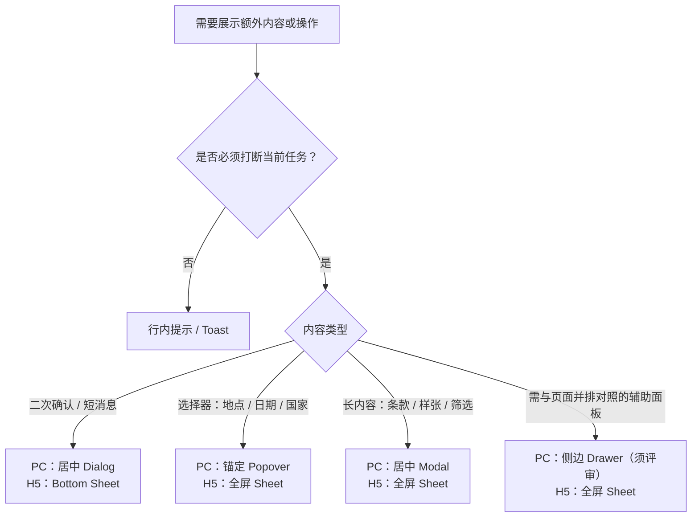

# TrustGo Design Guidelines：设计与体验原则

本指南指导设计师与开发者在实际工作中做体验决策。视觉数值见 [Design Tokens](design-tokens.md)，组件结构见 [Component Library](component-library.md)，栅格见 [Layout & Grid](layout-grid.md)，各页面的 PC / H5 落地方式见 [Page Patterns](page-patterns.md)。

## 1. 设计原则（对齐 Airbnb 风格）

| 原则 | 含义 | TrustGo 落地 |
| --- | --- | --- |
| 照片是主角 | 界面 chrome 退后，让内容与图片说话 | 内容卡片无阴影、少描边；图片占卡片视觉面积 ≥ 40% |
| 克制用色 | 品牌色只标记"可操作"与"已选中" | 图标默认 `Text/Primary`；品牌蓝不用于普通标题、装饰竖条和大段说明 |
| 留白分组，而非框线分组 | 用间距和分割线建立层级，不靠盒子套盒子 | 详情页各模块之间使用分割线 + `Space/xl`，取消"卡片里套带底色的卡片" |
| 一屏一个主操作 | 每个视口只有一个视觉最强的按钮（例外：结果列表中每张车辆卡片各一个"选择"） | 次要操作使用 Secondary / Text Button；取消预订等破坏性操作不与主 CTA 并列 |
| 渐进披露 | 先给结论，细节按需展开 | 首屏显示总价、免费取消、关键配置；完整条款用"Show all"打开弹层 |
| 透明可信 | 价格、规则、时间不让用户猜 | 总价含税说明、免费取消截止的门店当地时间、押金金额在决策点前可见 |
| 同一语义，两种形态 | PC 与 H5 共享业务状态与规则，只改变布局和容器 | 同一组件在 PC 用 Popover / Modal，在 H5 用全屏 Sheet；不复制业务逻辑 |

## 2. 摄影与图像（Photography）

| 场景 | 要求 |
| --- | --- |
| 品牌与营销区（Hero、自驾灵感、门店城市图） | 真实旅行场景，光线温暖，带公路、海岸、山林等目的地元素，体现 Freedom to Explore |
| 库存车辆图（来自 FE） | FE 车辆图多为白底棚拍图，属于业务事实，可直接使用：放在 `Background/Subtle` 底色的固定比例容器中，`object-contain` 居中，不裁切车身 |
| 车型说明 | 车辆图下方或名称旁显示"or similar / 或同級車型"，与车队车型组规则一致，不暗示保证具体车型；ToC 界面不展示 ACRISS / SIPP 等行业技术代码 |
| 文字叠图 | 仅 Hero 与营销 Banner 允许；必须使用渐变遮罩确保文字对比度 ≥ 4.5:1 |

**图片比例**（全站统一，避免列表中高低不齐）：

| 用途 | 比例 |
| --- | --- |
| 车辆卡片、车辆详情主图 | 4:3 |
| 门店卡片、自驾灵感卡片 | 3:2 |
| Hero（PC） | 全宽，高度 560–640px |
| Hero（H5） | 4:5 或 1:1，高度不超过首屏 60% |

**Don't**：Hero 背景图降低到 25% 透明度再叠白色渐变——这会让"照片是主角"失效，应保留照片原貌，只在文字区域使用局部遮罩。

## 3. 色彩使用

### 3.1 用色预算

"干净"来自强调色出现得少。品牌蓝只允许出现在下表"品牌蓝"一列的位置，其余一律中性色：

| 元素 | 品牌蓝（`primary` / `brand`） | 中性色（`foreground` 系列） | 暖阳橘（`warm`） |
| --- | --- | --- | --- |
| 主按钮（每屏一个） | ✓ `Primary-Strong` 填充 | — | — |
| 文字链接、"Show all"、文字操作 Hover | ✓ `Primary-Strong` 文字 | 默认轻量文字操作可用中性色 | — |
| 选中卡片 / 输入框 Focus | ✓ `Brand/Primary` 描边 | — | — |
| 日历选中区间、进度条 | ✓ | — | — |
| 导航当前项 | — | ✓ 加粗 + 2px 下划线 | — |
| Header 次要入口（客服、查单） | — | ✓ Ghost / Secondary 按钮 | — |
| 筛选 Chip 选中态 | — | ✓ `Text/Primary` 描边 / 深色底白字 | — |
| 图标、标题、规格信息 | — | ✓ | — |
| 促销角标、评分星星 | — | — | ✓ |

- 禁止：渐变色块 Banner、标题上方的小标签胶囊（eyebrow）、给每个图标加浅蓝底圆、用品牌蓝做大段文字。
- 营销区（Hero、加盟 Banner）用真实照片 + 局部遮罩承载氛围，不用品牌色渐变。

### 3.2 Do / Don't

| Do | Don't |
| --- | --- |
| 主 CTA 使用 `Primary-Strong` 填充 + 白字 | 用 `#25A5E3` 填充按钮再叠白字（对比度不足） |
| 选中态使用 2px `Brand/Primary` 描边 + 可选 `Primary-Light` 底色 | 选中态同时改变底色、描边、阴影、文字颜色、缩放 |
| 免费取消、不限里程等正向信息使用 Success 色的文字与图标 | 所有正向信息都用绿色粗体，造成页面"满屏绿" |
| 促销与评分使用暖阳橘 | 用暖阳橘表达错误或警告 |
| 图标与文字同色（默认 `Text/Primary` 或 `Text/Secondary`） | 每个图标都染成品牌蓝 |

## 4. 排版使用

- 层级只依靠 [Design Tokens §2](design-tokens.md) 的字号阶梯和字重，不使用标题前的彩色竖条、全大写小标签或 900 字重。
- 一个卡片内最多 3 级文字层级：标题（`Type/Title`）、正文（`Type/Body`）、元信息（`Type/Caption`）。
- 价格是唯一允许"跳出来"的数字：使用 `Type/Price`，其余数字保持正文字号。
- 多语言文本按最长语言设计：西班牙语通常比英语长约 30%，按钮、Tab、Chip 不得写死宽度，允许换行或截断并提供完整文本（`title` 或展开）。

## 5. 文案与沟通（UX Writing）

传递 Easygoing 与 Friendly 的语气，术语遵循 [`AGENTS.md`](../../AGENTS.md) 的租车业务领域术语表。

| 规则 | 坏示例 | 好示例 |
| --- | --- | --- |
| 标题清楚直接 | Vehicle Availability Results | Cars available in Sydney |
| 错误友好且可行动 | Error: Validation Failed. | Oops! Please select a pick-up date first. |
| 用保障语言替代强制语言 | Mandatory Insurance Policies | Travel with Confidence — your coverage details |
| Sentence case | FREE CANCELLATION | Free cancellation |
| 时间带上下文 | Free cancellation up to 48h | Free cancellation until 10 Nov, 10:00 (local time) |
| 价格说清含什么 | $320 | $320 total · incl. taxes & fees |
| 不承诺无法保证的事 | Guaranteed Toyota Corolla | Toyota Corolla or similar |
| 不暴露系统实现 | Simulated transaction / Mock order | （直接展示真实业务语义；无数据时显示空状态） |

长说明拆成要点或"图标 + 短句"，单条不超过两行；法律条款保留原文但默认折叠。

## 6. 交互与动效（Interaction & Motion）

动效帮助理解，而不是炫技。时长与曲线见 [Design Tokens §6](design-tokens.md)。

### 6.1 状态反馈

| 元素 | Hover（仅 PC 指针设备） | Pressed | Focus-visible |
| --- | --- | --- | --- |
| 主按钮 | 背景加深到 `Primary-Strong-Hover` | `scale(0.98)` | 2px `Brand/Primary` Focus Ring + 2px 偏移 |
| 次要按钮 / 未选中 Chip | 背景变为 `Background/Muted` | 背景 `Background/Muted` | 同上 |
| 已选中 Chip | 保留中性选中态，深色底适度变浅 | 同 Hover | 同上 |
| 内容卡片（整卡可点） | 图片 `scale(1.02)` **或** 标题下划线，二选一 | 不做位移 | 卡片外 2px Focus Ring |
| 文字链接 / 文字操作 | `Primary-Strong` 文字 + 下划线 | 文字操作使用 `Primary-Light` 浅底 | 同上 |

重复列表中的预订入口默认使用中性 Secondary，可在 Hover 时使用 `Primary-Strong` 填充与白字、Pressed 时使用 `Primary-Strong-Hover`；不将所有列表按钮同时设为品牌色主按钮。

- Hover 效果用 `@media (hover: hover)` 或 Tailwind `hover:` 限定，触屏设备不得出现"粘住"的 Hover 态。
- 卡片 Hover 只允许一种变化，不叠加阴影加深、边框变色和上浮位移。
- 所有可点击元素的命中区域 ≥ 44 × 44px；整卡可点的卡片使用单一 `<a>` 包裹，内部不再嵌套其他可点击元素（收藏等次要操作除外，需阻止冒泡）。

### 6.2 加载与过渡

- 列表、详情首屏使用与真实布局一致的骨架屏（Skeleton），禁止整页 Spinner。
- 按钮提交中保持原宽度，显示行内 Spinner 与进行时文案（"Searching…"），并禁止重复提交。
- 报价过期、库存刷新等后台更新不打断用户：先用行内提示，必要时再弹 Dialog。

## 7. 弹层与抽屉（Overlays）

这是 PC 与 H5 差异最大的地方。原则：**PC 优先就地展开（Popover / 居中 Modal），H5 优先全屏或自下而上的 Sheet；右侧抽屉（Side Drawer）在 C 端官网中默认不使用**。

### 7.1 选择流程

### 7.2 场景对照

| 场景 | Desktop ≥ 1024 | Tablet 768–1023 | Mobile < 768 |
| --- | --- | --- | --- |
| 取还车地点搜索 | 搜索栏下方锚定 Popover（宽 ≥ 480px） | 居中 Modal | 全屏 Sheet：顶部返回 + 自动聚焦输入框 |
| 日期与时间选择 | 锚定 Popover，双月日历 | 居中 Modal，双月日历 | 全屏 Sheet，单月纵向滚动日历 + 吸底"Next / Done" |
| 驾照签发国 / 驾驶人年龄 | 锚定 Popover | 锚定 Popover | 全屏 Sheet（可搜索列表） |
| 筛选 Filters | 居中 Modal（宽 720px），底部固定"Clear all / Show N cars" | 同 PC | 全屏 Sheet，底部固定同样两个按钮 |
| 排序 | 下拉菜单 | 下拉菜单 | Bottom Sheet 单选列表 |
| 保险说明、免赔额解释 | 居中 Modal（宽 640px） | 同 PC | 全屏 Sheet |
| IDP / 证件样张 | 居中 Modal（宽 780px），内部左侧国家目录 + 右侧内容 | 居中 Modal，顶部国家 Tab | 全屏 Sheet，顶部横向国家 Chip |
| 门店地图、取车指引 | 居中 Modal（宽 960px） | 全屏 Modal | 全屏 Sheet |
| 价格明细 | 在吸顶价格卡内展开 | 同 PC | 从吸底栏"Price details"拉起 Bottom Sheet |
| 取消预订确认 | 居中 Dialog（宽 480px） | 同 PC | Bottom Sheet |
| 报价过期提醒 | 居中 Dialog | 同 PC | Bottom Sheet |
| 主导航菜单 | 横向导航 + 下拉菜单 | 汉堡菜单 → 全屏 Sheet | 汉堡菜单 → 全屏 Sheet |
| 图片大图预览 | 全屏 Lightbox | 同 PC | 同 PC，支持左右滑动 |

### 7.3 弹层通用规则

| 规则 | 说明 |
| --- | --- |
| 基于 Radix 原语 | Dialog / Sheet / Popover 统一基于 `@radix-ui/react-dialog`、`@radix-ui/react-popover` 构建的共享组件，禁止各模块手写 `fixed inset-0` 弹层 |
| 焦点管理 | 打开时焦点移入弹层，Tab 循环在弹层内，关闭后焦点回到触发元素 |
| 关闭方式 | ESC、遮罩点击、关闭按钮三者都可关闭；有未保存输入时先确认 |
| 背景滚动 | 打开时锁定页面滚动，弹层内部独立滚动 |
| 返回键 | H5 全屏 Sheet 打开时，浏览器返回优先关闭 Sheet 而不是离开页面 |
| 高度 | H5 使用 `100dvh`，不使用 `100vh`；Bottom Sheet 最大高度 90dvh |
| 安全区域 | 吸底按钮区包含 `env(safe-area-inset-bottom)` |
| 软键盘 | 含输入框的 Sheet 中，聚焦输入时内容区可滚动到输入框可见，吸底按钮不得遮挡输入框 |
| 层叠 | 最多两层（如 Modal 内打开图片预览）；禁止 Modal 内再开 Modal 做业务流程 |
| 标题 | 每个弹层有可见标题并关联 `aria-labelledby` |

### 7.4 为什么不用右侧抽屉

| 问题 | 说明 |
| --- | --- |
| PC 上视线割裂 | 宽屏下抽屉贴右边缘，阅读区域偏离视觉中心，长内容（如 IDP 样张）阅读体验差于居中 Modal |
| H5 上退化为全屏 | 抽屉在小屏上本就是 `w-full`，与全屏 Sheet 无区别，却缺少自下而上的进入方向与返回手势预期 |
| 与 Airbnb 心智不符 | Airbnb 的"Show all amenities / House rules"等长内容均使用居中 Modal（PC）与全屏 Sheet（H5） |

右侧抽屉仅在"用户需要边看页面边操作面板"的场景（如未来的对比车辆面板）中评审后使用。

## 8. 复杂信息降维（Information Architecture）

把复杂的 car rental 选择变成容易理解的探索过程。

| 规则 | 说明 |
| --- | --- |
| 首屏只放决策必需信息 | 车辆列表：车型、"or similar"、座位 / 行李 / 变速箱、免费取消、总价。车型代码、供应商门店类型等降为 `Type/Caption` |
| 高频筛选外露，低频筛选收起 | 外露 3–5 个快速筛选 Chip（车型组、自动挡、免费取消、零免赔额）；其余放入"Filters"弹层 |
| 总价优先 | 列表与详情以**租期总价**为主价格，日均价为辅助信息，并标明是否含税费 |
| 政策可读 | 取消政策用时间轴展示每个截止时间点与对应罚金；时间以门店当地时区显示并注明 |
| 规格不用盒子 | 座位、行李、变速箱、燃油用"图标 + 文字"行内排列并以 `·` 分隔，不给每项加底色和描边 |
| 视觉降噪 | 次要文本使用 `Text/Tertiary`；同一卡片中绿色正向信息不超过 2 条，其余并入"What's included"列表 |
| 少说明，多示意 | 一眼能看懂的控件不加提示文案；页面标题下最多一句副标题，不写"浏览…、确认…、了解…"式的功能介绍 |

### 8.1 导航与返回路径

| 场景 | 方式 | 不使用 |
| --- | --- | --- |
| 一级导航页（门店分布、车行加盟、查单） | 顶部导航当前项高亮 | 面包屑、"返回首页"链接 |
| ≥ 3 级内容页（门店详情、帮助文章） | H1 上方小字面包屑（`Type/Caption`），同时输出 `BreadcrumbList` 结构化数据 | — |
| 搜索结果 | Header 下方吸顶的紧凑搜索摘要（地点 · 日期 · 租期 · 编辑），点击展开搜索控件 | 面包屑 |
| 费率详情 → 驾驶人信息 → 支付 | Header 下方吸顶的步骤条，左侧返回箭头；H5 显示"第 2 步，共 3 步 · 驾驶人信息" | 面包屑、页内"返回上一步"文字链接 |

一级导航页虽不显示面包屑，仍可输出 `BreadcrumbList` 结构化数据供搜索引擎使用。

## 9. 页面状态

每个页面与关键组件都必须设计以下状态，状态文案遵循 §5：

| 状态 | 要求 |
| --- | --- |
| Loading | 与真实布局一致的骨架屏 |
| Empty | 插画或图标 + 一句话原因 + 1 个主恢复操作（如"Change dates"）+ 最多 1 个次要操作 |
| Error | 说明发生了什么、用户的数据是否安全、下一步做什么；提供重试 |
| 部分可用 | 例如部分车辆报价失败：保留可用结果，在列表顶部行内提示 |
| 过期 | 报价 / 库存过期：行内提示 + "Refresh prices"，刷新后保留用户已选条件 |

## 10. 无障碍与可用性底线

- 文字对比度 ≥ 4.5:1，大号文字（≥ 24px 或 ≥ 18.66px 粗体）与控件边界 ≥ 3:1。
- 不以颜色作为唯一信息载体：状态同时使用图标或文字。
- 所有表单字段有可见 Label；错误信息紧邻字段并通过 `aria-describedby` 关联。
- 整卡可点、图标按钮须有可读的无障碍名称，且随语言切换。

## 11. 设计评审清单

提交 UI 变更前逐项自检：

- [ ] 未使用未定义的颜色、圆角、阴影、z-index 与字号（见 [Design Tokens](design-tokens.md)）
- [ ] 内容卡片圆角为 12px 且默认无阴影；未出现卡片套卡片
- [ ] 每个视口只有一个主 CTA；主 CTA 对比度达标
- [ ] PC 与 H5 均已覆盖，弹层形态符合 §7.2
- [ ] H5 关键页面有吸底主操作，且适配安全区域与软键盘
- [ ] Loading / Empty / Error 状态已覆盖
- [ ] 五种语言下无溢出、无截断丢失关键信息
- [ ] 无 10px / 11px 文字、无 800 / 900 字重、无全大写小标签
- [ ] 品牌蓝只出现在 §3.1 允许的位置；无渐变 Banner、无 eyebrow 小标签
- [ ] 面包屑与返回路径符合 §8.1
