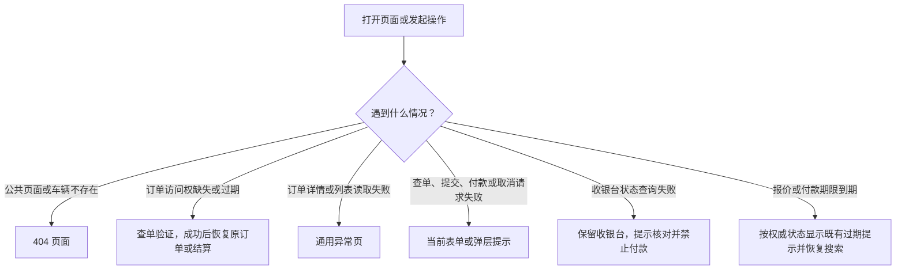

# 异常页面、提示与恢复路径说明

核对日期：2026-10-28。适用当前 TrustGo 主流程、预订、查单与订单页面。本文描述当前代码行为和人工触发方法，不修改页面、交互或业务规则。

**要直接填写测试数据，请先看 [预订流程测试输入与预期输出](booking-test-input-output.md)**：包括固定查单故障号、检修页测试地址、具体取还车参数、有车／无车结果，以及卡号／有效期／CVC 的具体输入。

原审计中“未授权订单直接 404”“订单服务异常也变成 404”“查单失败全部当作未找到”属于修复前结论；当前以本文为准。修复范围与回归记录见 [预订逻辑补漏记录](../reviews/booking-logic-gap-fixes-2026-10-28.md)。

## 1. 先区分四种结果

| 类型 | 用户实际看到什么 | 是否跳到独立异常 URL |
| --- | --- | --- |
| 404 页面 | 带 404 路标的车辆插图、页面不存在说明、返回首页按钮 | 不需要 `/404` 路由，通常保留触发它的错误地址 |
| 通用异常页 | 检修车辆插图、“A quick pit stop!” 对应语言标题、重试与首页按钮 | 不跳 `/500`，在当前业务路由由错误边界接管 |
| 业务恢复页 | 查单验证表单、搜索结果或费率详情 | 会按业务规则重定向；不表示系统故障 |
| 页面内提示／弹层 | 表单错误、支付核对横幅、费率过期弹层、取消试算错误等 | 通常留在当前页面；没有对应的独立异常 URL |

同一条 API 的 404、429 或 503，不等于浏览器一定展示对应的整页错误。最终展示取决于调用它的页面如何处理；Next.js 在响应已开始流式输出后也可能无法更改外层 HTTP 状态，验收时应分别记录 API 状态、页面画面和最终地址。

## 2. 哪些情况进入整页异常

| ID | 触发情况 | 进入位置与页面结果 | 可以怎样恢复 |
| --- | --- | --- | --- |
| P01 | 打开不存在的公共页面或未注册路径 | 已匹配语言路由使用 `[lang]/not-found.tsx`；未匹配路由使用独立的 `global-not-found.tsx` 文档 | 返回首页并使用有效入口 |
| P02 | 费率详情的车辆 ID 不存在 | 404 页面；不会用第一辆车代替 | 从搜索结果重新选车 |
| P03 | 有效报价 ID 属于另一辆车，却搭配当前车型路径 | 404 页面 | 使用原报价的车型链接，或重新选车 |
| P04 | 国家／城市／门店路径不存在或层级错配；帮助 FAQ topic 不存在 | 对应页面判定后进入 404 | 回有效的目的地、门店或帮助入口 |
| P05 | 首次打开订单详情或收银台时，有读取上下文，但订单服务不可用或发生其他未处理读取错误 | `/{lang}/error.tsx`：通用异常页；不伪装为 404 | 服务恢复后点重试；不能靠更换确认号修复服务故障 |
| P06 | 订单详情已打开，后续同步遇到断网、超时、429、503 等非 `booking_not_found` 错误 | 订单详情抛给通用异常页 | 恢复连接／解除限流后重试 |
| P07 | 访客订单列表 `/manage-booking/orders` 读取失败 | 通用异常页，不显示“没有订单” | 恢复服务后重试 |
| P08 | `/manage-booking` 入口已有会话，服务端读取会话订单失败 | 通用异常页；正常无会话时仍进入验证表单 | 服务恢复后重试 |
| P09 | 语言段内页面发生未被捕获的渲染错误 | 通用异常页 | 临时故障可重试；代码缺陷需修复 |
| P10 | 根布局发生无法由下层错误边界处理的渲染错误 | `global-error.tsx`：全屏检修兜底，当前为英文，只有 Restart Session 操作 | 重试；不能恢复时需修复根布局故障 |

没有会话时，普通订单／结算会先进入查单验证，因此不应以“无痕打开普通订单”作为 P05 服务异常页的复现方法。开发／测试环境新增保留故障号，不含真实订单数据，可无会话直接检验现有错误边界，见下方。

当前未提供独立的 `/404`、`/500` 或“异常预览”业务路由。直接访问 `/en/500` 会被当作不存在的内容路径，看到的是 404，不能用来验收通用异常页。全局错误兜底也没有直接访问地址。

## 3. 哪些情况不会进入整页异常

| 场景 | 当前结果 | 用户下一步 |
| --- | --- | --- |
| 无会话、会话过期、订单不存在或当前用户无权读取该订单 | 订单／收银台跳 `/{lang}/manage-booking?returnTo=...`，再进入查单表单；这些原因不会通过页面区分，以避免泄露订单是否存在 | 输入确认号和主驾驶人姓氏；只恢复本次验证通过的同语言、同确认号订单或结算页 |
| 已打开订单／收银台，后续同步返回 `booking_not_found/404` | 清空该展示入口并跳重新验证，不继续展示旧订单 | 重新验证；无法验证时联系支持 |
| 访客查单确认号或姓氏不匹配 | `POST /api/rental/guest-lookup` 返回 404，表单原地显示统一“未找到”提示，保留输入 | 核对资料后重试 |
| 访客查单遇到断网、超时、非 JSON 或 503 | 查单表单显示临时服务异常，保留输入；不说“未找到” | 网络／服务恢复后重新提交 |
| 访客查单遇到 429 | 查单表单提示稍后再试，保留输入 | 等待限流窗口恢复 |
| 收银台已打开，后续状态同步遇到网络／429／503 | 保留收银台，在既有横幅提示核对／服务异常，禁用付款；不进入整页异常 | 后台可见时定时重查，或恢复前台触发查询 |
| 无授权订单的访客列表，或清除查单会话成功 | 跳现有查单表单 | 逐笔重新验证；清会话不取消订单 |
| 搜索无库存、不支持的异地组合、未知地点身份 | 正常空结果 | 修改搜索条件 |
| 已有搜索参数的日期／时间非法或已过取车时刻 | 结果页现有行内提示，不返回可订报价；搜索栏提交非法时间时打开原日期选择入口 | 修正时间后搜索 |
| 费率过期，公共快照仍在展示保留期 | 费率详情复用既有过期弹层；驾驶人页会先返回该费率详情 | 重新查询报价，不能继续提交旧报价 |
| 报价 ID 丢失、快照已清理、报价不可用 | 回安全的费率恢复路径或搜索结果；无上下文时回搜索入口 | 重新选车／查价 |
| URL 的保障或设备参数非法 | 归一化为有效默认选择 | 核对保障及设备后继续 |
| 驾驶人字段校验失败 | 当前字段反馈；服务端返回字段信息时也定位对应字段 | 修正后提交 |
| 创建预订遇到冲突、报价过期／不可用、服务失败 | 驾驶人页主操作附近的现有提示；根据错误提供继续已有待付款单、查看订单或重新查价入口 | 使用对应恢复操作；不另开整页异常 |
| 支付提交失败或结果不确定 | 先查单；已确认支付进入订单详情，无法确认时禁止重付并原地提示 | 等待权威查单结果，不凭报错直接认定未扣款 |
| 浏览器付款倒计时归零，但未取得服务端最终状态 | 停止付款，显示核对状态；不会单凭本地时钟宣布订单取消 | 等待状态查询 |
| 服务端已确认 `CANCELLED + payment_timeout`，且没有同步错误、付款中／未知等阻断条件 | 既有超时横幅与超时弹层；取消弹层打开时暂不弹出，已关闭的超时弹层本次挂载中不再自动重开 | 重新搜车；主动取消不触发这类超时弹层 |
| 取消试算／提交失败、费用版本已变化 | 保留当前取消弹层，显示错误并要求重新核对试算；丢失取消响应时先查最新订单 | 重新获取试算并确认，不能以未知金额当作免费 |
| 打开未知 API 路径 | 返回 JSON `invalid_request/404` | 这是接口响应，不是品牌 404 页面 |

未加语言前缀或使用不支持的前缀时，中间件先补当前偏好语言。例如 `/fr/rent` 可能先转为 `/en/fr/rent`，随后因不存在的路径进入 404；不能把它理解成支持法语。没有语言前缀的有效路径可能正常补语言后打开。

## 4. 人工怎么进入和验证

先用项目入口 `npm run preview` 启动或复用本地服务。以下用英文地址举例，替换 `/en/` 可验 `zh / ja / es / ko`；分别检查 PC 1440×900、Tablet 820×1180、H5 390×844。`{code}`、`{rateId}` 必须使用当前测试会话实际生成的数据，不在文档中记录驾驶人资料。

| 用例 | 地址与操作 | 应看到什么 |
| --- | --- | --- |
| 最容易直接打开的 404 | [未知内容](http://localhost:4000/en/does-not-exist)、[未知车辆](http://localhost:4000/en/rent/does-not-exist)、[未知门店](http://localhost:4000/en/locations/does-not-exist) | 品牌 404 页面；点击首页后回 `/en` |
| 报价车型错配 404 | 正常搜索打开一辆车的费率，取得 `rateDetailsId`；保留该 ID，将车型路径改为另一已知车型，如 `/en/rent/hyundai-i30-compact?rateDetailsId={rateId}`，前提是原报价不属于该车 | 品牌 404 页面；无效／已丢失的 ID 会回搜索，不能用来验证“有效报价与车型错配” |
| 未授权订单恢复 | 在无痕窗口打开 `http://localhost:4000/en/booking/{code}` 或 `/en/checkout/{code}`，不要登录已有归属账户 | 查单表单；正确验证后返回原订单／收银台。错误凭证留在表单，均不应出现 404 整页 |
| 查单“未找到” | [查单表单](http://localhost:4000/en/manage-booking/lookup)，填测试确认号及不匹配的测试姓氏并提交 | 表单原地统一提示，API 404，输入保留 |
| 查单断网提示 | 先完整打开查单表单，再在浏览器开发者工具 Network 设 Offline，提交表单 | 表单内临时服务错误；恢复网络后可重试。不应显示“未找到”或整页检修图 |
| 查单 429 提示 | 在隔离的测试环境、同请求来源对查单入口一分钟内连续提交超过 10 次；或由测试代理返回 `429` 与 `{"code":"try_later"}` | 表单内稍后再试；当前服务端查单计数窗口为 60 秒，同来源会共享限流 |
| 查单 503 提示 | 先打开表单，由测试环境代理／接口故障注入让 `POST /api/rental/guest-lookup` 返回 `503` 与 `{"code":"service_unavailable"}`，再提交 | 表单内服务异常，输入保留。只改地址不会制造 503 |
| 固定查单故障输入（开发／测试环境） | 表单填 `TG-QA-SERVICE-503`／`TG-QA-RATE-429`／`TG-QA-TIMEOUT-504`／`TG-QA-BAD-RESPONSE`，姓氏 `Traveler` | 分别返回 503、429、504、502 非 JSON；表单显示服务异常／稍后再试，不误报未找到 |
| 固定首屏异常地址（开发／测试环境） | 打开 [订单检修页](http://localhost:4000/zh/booking/TG-QA-SERVICE-503) 或 [收银台检修页](http://localhost:4000/zh/checkout/TG-QA-SERVICE-503) | 现有整页检修画面，不要求先验证真实订单；固定故障下点重试仍失败 |
| 订单详情通用异常页 | 先在联网状态完整打开已授权订单，再用浏览器 Network Request Blocking 阻断 `/api/rental/bookings/{code}` 的查询请求，恢复页面焦点或等待可见页面下一次同步（约 5 秒） | 当前订单地址出现检修通用异常页。解除阻断后点重试，应重新查询 |
| 访客订单列表通用异常页 | 先确保当前会话有已授权订单并完整打开 [会话订单列表](http://localhost:4000/en/manage-booking/orders)，对 `/api/rental/guest-bookings` 设置请求阻断；恢复页面焦点或等待约 15 秒 | 检修通用异常页，不是“没有订单”。解除阻断后重试 |
| 收银台查询异常状态 | 先完整打开一笔可付订单的 `/en/checkout/{code}`，阻断 `/api/rental/bookings/{code}` 查询并等待同步 | 留在收银台，横幅提示异常，付款禁用；解除阻断并重新同步后按真实状态恢复 |
| 费率过期 | 正常搜索打开费率详情，停留超过报价有效期（当前内部适配为 3 分钟）；验证刷新恢复时，使用从“继续”链接取得的 ID 打开 `/en/rent/{vehicleId}?rateDetailsId={rateId}`，或打开该旧报价的驾驶人页 | 现有报价过期弹层，可重新查价；不进入检修整页。原地址若没有旧报价 ID，直接刷新可能生成新报价，不能据此判断过期恢复失效 |
| 付款超时 | 创建待付款订单后停留在收银台，等待服务端截止时间（当前内部占位最多 15 分钟，也可能被取车时间截短） | 本地到期即禁付；服务端确认超时取消后出现既有超时弹层 |
| 取消试算异常 | 打开可取消订单，阻断对应 `cancellation-estimate` 请求，再打开取消弹层 | 弹层内加载失败与重试，未取得金额前不能确认；不进入整页检修 |

请求阻断或 Offline 应在业务页已经加载后启用。若先把整个站点断网，再在地址栏打开页面，可能只有浏览器自身的网络错误页，不能据此验收 TrustGo 的错误边界。

### 需要开发环境故障注入的情况

| 目标 | 触发条件与限制 |
| --- | --- |
| 首屏服务端故障进入通用异常页 | 开发／测试环境可用保留号地址直接验证边界；真实订单仍需有效访问上下文及实际读取失败。production 不启用保留号故障，内部适配的默认拒绝服务保护保留。浏览器阻断 API 只能影响客户端请求 |
| 根布局的全局错误兜底 | 需要在独立开发测试环境受控触发根布局渲染失败，再立即撤销注入。没有普通业务点击路径，不能通过访问 `/global-error` 或在控制台随意 `throw` 来证明全局兜底正常 |
| 真实支付渠道的拒付／3DS／回调异常 | 内部测试卡已能触发拒付、余额不足、认证失败、处理中／未知及付款服务失败反馈，具体输入见测试输入表；真实 3DS 交互、验签及回调仍需支付测试环境，不以内部结果代替验证 |

未增加页面控件或新业务路由；固定故障仅在开发／测试环境识别保留号，可用服务端 `TRUSTGO_LOCAL_FAULTS=off` 关闭并重启预览。它们不创建订单、不授予权限、不改变真实交易状态。504 用例立即返回上游超时结果，不等于真实客户端超时。普通确认号继续使用原业务规则。全部页面操作仍待人工确认。

## 5. 核对依据与维护

| 行为 | 代码依据 |
| --- | --- |
| 404、通用异常、根布局兜底 | `src/app/[lang]/not-found.tsx`、`src/app/global-not-found.tsx`、`src/shared/ui/not-found-view.tsx`、`src/app/[lang]/error.tsx`、`src/app/global-error.tsx` |
| 订单首屏分类与安全恢复 | `src/modules/booking-management/application/read-page-booking.ts`、`src/modules/booking-management/domain/access-recovery.ts` |
| 订单／收银台同步后的不同表现 | `src/modules/booking-management/application/use-booking-sync.ts`、`src/app/[lang]/booking/[confirmationCode]/BookingDetailsView.tsx`、`src/app/[lang]/checkout/[reservationId]/CheckoutCashierView.tsx` |
| 查单错误分类、列表失败与入口分流 | `src/modules/booking-management/ui/GuestBookingLookupCard.tsx`、`src/modules/booking-management/application/use-guest-session.ts`、`src/app/[lang]/manage-booking/` |
| 报价失效与车辆校验 | `src/app/[lang]/rent/[id]/page.tsx`、`src/app/[lang]/book/driver/page.tsx` |
| 付款超时横幅与弹层条件 | `src/modules/checkout/ui/RateLockHoldBanner.tsx`、`src/modules/checkout/ui/CheckoutExpiryDialog.tsx`、`CheckoutCashierView.tsx` |
| 接口状态、网络失败与限流 | `src/app/api/rental/[...action]/route.ts`、`src/modules/booking-management/application/booking-store.ts`、`src/server/rental-access.ts` |

逻辑回归入口为 `npm run test:booking-recovery`。自动测试验证分类、恢复和部分渲染绑定；本说明不将它等同于 PC／Tablet／H5 五语言的实际点击验收。后续新增业务异常，应同步更新这里的触发条件、展示位置、恢复动作和人工步骤。
