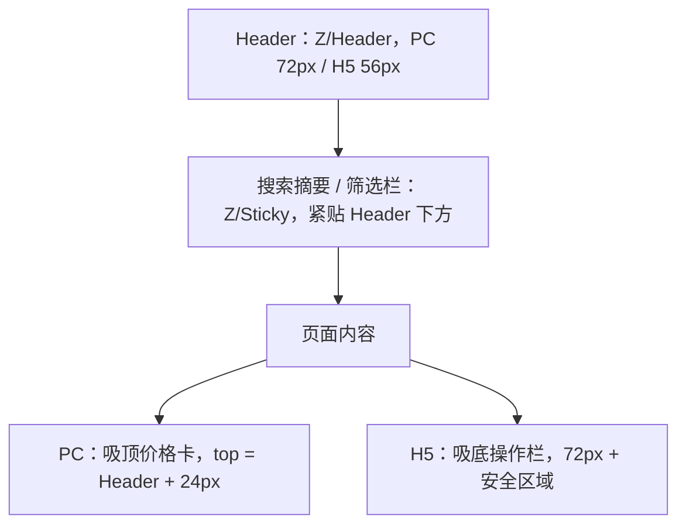

# TrustGo Layout & Grid：布局与栅格系统

TrustGo 的布局强调充足留白与清晰结构，实现"轻盈、舒展"的视觉感受。所有页面采用**移动优先**实现：先完成 Mobile 布局，再在 `md` / `lg` 断点逐级增强，不得先做桌面再缩放。

## 1. 响应式断点（Breakpoints）

| 档位 | 视口宽度 | 基准设计稿 | Tailwind 前缀 |
| --- | --- | --- | --- |
| Mobile | < 768px | 375px（兼顾 360px 与 430px） | 无前缀（默认） |
| Tablet | 768–1023px | 768px | `md:` |
| Desktop | ≥ 1024px | 1440px（兼顾 1280px 与 1024px） | `lg:` |

- 布局结构只在 `md` 与 `lg` 切换。`sm:`（640px）与 `xl:`（1280px）只允许用于间距和字号微调，不得产生第四套布局。
- 全局 Header 在 Desktop 可用宽度不足以容纳当前语言与账户内容时，复用 Tablet / Mobile 折叠菜单；此规则按内容是否放得下判断，不新增设备断点。
- Tablet 横屏（≥ 1024px）按 Desktop 处理；Tablet 竖屏以"放大的 Mobile"为基础，可使用两列卡片。

## 2. 栅格系统（Grid Rules）

| 参数 | Mobile | Tablet | Desktop |
| --- | --- | --- | --- |
| 列数 | 4 | 8 | 12 |
| 列间距（Gutter） | 16px | 16px | 24px |
| 页边距（Margin） | 16px | 32px | 至少 40px；容器达到最大宽度后自动居中 |

> [!NOTE]
> 旧规范中 Desktop "页边距最少 120px"在 1024–1280px 宽度下会把内容压缩到 800px 左右，与 1200px 容器矛盾，已改为"至少 40px + 最大宽度居中"。

### 2.1 容器宽度

| 容器 | 最大宽度 | 适用页面 |
| --- | --- | --- |
| `Container/Wide` | 1440px | 搜索结果（含地图）、门店列表（含地图） |
| `Container/Default` | 1200px | 首页、车辆详情、驾驶人信息、结算、订单详情、内容页 |
| `Container/Header` | 1600px | 全局 Header；独立于正文容器，沿用各端页边距 |
| `Container/Narrow` | 720px | 帮助文章、政策条款、加盟表单 |
| `Container/Form` | 440px | 访客查单、登录、注册 |

## 3. 页面布局模板

| 模板 | Desktop | Tablet | Mobile |
| --- | --- | --- | --- |
| 主内容 + 吸顶侧栏 | 8 列内容 + 4 列吸顶价格卡（间距 48px） | 单列；价格卡改为吸底操作栏 | 单列 + 吸底操作栏 |
| 列表 + 地图 | 列表 7 列 + 地图 5 列（地图吸顶，高度 = 视口 − Header） | 列表全宽，浮动"Map"按钮切换全屏地图 | 同 Tablet |
| 卡片网格 | 3–4 列 | 2 列 | 1 列，或横向滑动轨道 |
| 单列表单 | 居中 `Container/Form` 或 `Container/Narrow` | 同 Desktop | 全宽，16px 页边距 |

## 4. 垂直节奏（Vertical Rhythm）

| 间距 | Mobile | Desktop |
| --- | --- | --- |
| 模块（Section）之间 | 48px（`Space/2xl`） | 64–96px（`Space/3xl`–`Space/4xl`） |
| 模块标题与内容 | 16px | 24px |
| 详情页子模块之间 | 32px，中间 1px 分割线 | 40px，中间 1px 分割线 |
| 卡片列表项之间 | 16px | 24px |
| Header 与页面标题 | 24px | 32px |

旧规范中"模块间距至少 64px"适用于 Desktop；在 375px 屏幕上 64px 会造成大量空滚动，H5 统一为 48px。

## 5. 吸顶与吸底（Sticky Elements）

| 规则 | 说明 |
| --- | --- |
| 吸顶元素总高度 | H5 上所有吸顶元素合计不超过 112px（Header 56px + 筛选栏 56px），保证内容区可见 |
| 滚动方向 | H5 结果页可在向下滚动时隐藏 Header、保留筛选栏，向上滚动时恢复 |
| 吸底操作栏 | 仅用于有明确下一步的页面（车辆详情、驾驶人信息、结算、订单详情的主操作）；首页、门店列表不使用 |
| 底部留白 | 使用吸底栏的页面在内容底部预留吸底栏高度 + 16px |
| 层级 | 吸顶 / 吸底元素使用 `Z/Sticky`，不得高于弹层 |

## 6. 安全区域与视口

- 根布局导出 `viewport`，设置 `viewportFit: 'cover'`，否则 `env(safe-area-inset-*)` 无效。
- 全屏元素使用 `100dvh` / `min-h-dvh`，不使用 `100vh` / `h-screen`（避免 iOS Safari 地址栏遮挡）。
- 吸底栏、Bottom Sheet、Toast 的底部内边距包含 `env(safe-area-inset-bottom)`；横屏时左右包含 `env(safe-area-inset-left/right)`。
- 禁止禁用缩放（不设置 `maximum-scale=1` 或 `user-scalable=no`）；通过 16px 输入字号避免 iOS 聚焦放大。

## 7. 触控与溢出

| 规则 | 说明 |
| --- | --- |
| 触控目标 | 所有可点击元素命中区域 ≥ 44 × 44px，相邻目标间距 ≥ 8px |
| 页面级横向溢出 | 禁止。任何断点下 `body` 不得出现横向滚动条 |
| 横向滑动轨道 | Chip 行、推荐卡片等可横向滚动：使用 `scroll-snap`，露出下一项约 15% 作为可滑动提示，首尾保留页边距；PC 提供左右箭头按钮 |
| 长文本 | 车型名、门店名最多两行后截断；地址一行截断，完整信息在详情中展示 |
| 表格 | 价格明细等使用"左标签 / 右数值"两列行布局，不使用横向滚动表格 |

## 8. 布局指导原则

- **照片优先**：首页 Hero 在 Desktop 使用全宽（Full-bleed）自驾旅行照片，搜索栏悬浮于照片下沿；H5 Hero 照片高度不超过首屏 60%，搜索药丸紧随其后并在首屏完整可见。
- **Z 字型与 F 字型阅读**：品牌卖点（Easy Booking、Travel with Confidence、Freedom to Explore）在 Desktop 使用图文交替的 Z 字型；搜索结果在 Desktop 使用 F 字型横向卡片（左图右信息），H5 使用竖向卡片。
- **分组靠留白与分割线**：同一页面内的模块之间使用间距和 1px 分割线区分，避免每个模块都包在带阴影的卡片里。
- **首屏完整**：H5 关键页面首屏必须能看到页面标题、核心信息与主操作（或吸底栏），不得被 Banner、提示条挤出首屏。

各页面的具体栅格与组件组合见 [Page Patterns](page-patterns.md)。
