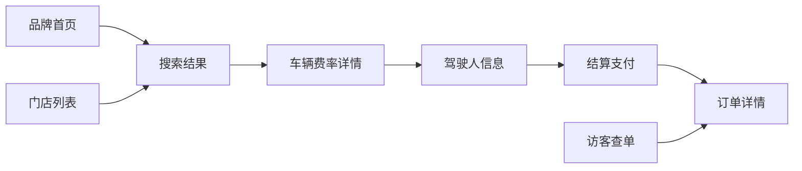
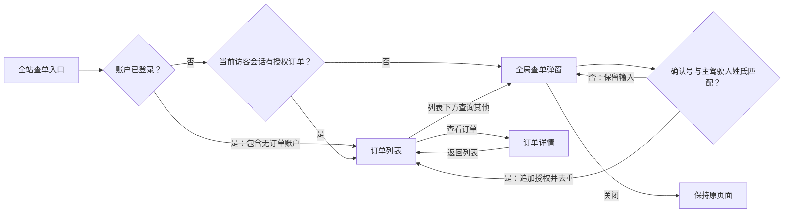

# TrustGo Page Patterns：页面模式

本文件只写每个页面的**目标、业务规则与状态**，不写列数、像素等布局数值——布局以代码为准，调整单页布局无需先改本文件。每个页面在同一节中同时描述 PC 与 H5 行为，两端共享同一业务语义、数据与状态规则。

## 1. 页面总览

| 页面 | 路由 | 容器 | 布局模板 | 索引策略 |
| --- | --- | --- | --- | --- |
| 品牌首页 | `/{lang}/` | Default | 全宽 Hero + 模块堆叠 | index |
| 门店列表 | `/{lang}/locations` | Wide | 列表 + 地图 | index |
| 门店详情（规划中） | `/{lang}/locations/{slug}` | Default | 主内容 + 吸顶侧栏 | index |
| 搜索结果 | `/{lang}/rent` | Wide | 筛选栏 + 列表（可选地图） | noindex（含个性化搜索参数） |
| 车辆费率详情 | `/{lang}/rent/{id}` | Default | 主内容 + 吸顶价格卡 / 吸底栏 | noindex |
| 驾驶人信息 | `/{lang}/book/driver` | Default | 表单 + 吸顶价格卡 / 吸底栏 | noindex |
| 结算支付 | `/{lang}/checkout/{reservationId}` | Default | 表单 + 吸顶价格卡 / 吸底栏 | noindex |
| 访客查单 | `/{lang}/manage-booking` | Form | 单列表单 | index（入口页） |
| 订单详情 | `/{lang}/booking/{confirmationCode}` | Default | 状态头 + 主内容 + 侧栏 | noindex |
| 内容页 / 加盟 | `/{lang}/{slug}`、`/{lang}/franchise` | Narrow / Default | 文章 / 图文交替 | index |
| 客户服务 | `/{lang}/help/customer-service` | Narrow | 阶段指引与自助／联系入口 | index |

## 2. 品牌首页

**目标**：3 秒内让用户开始搜索，同时建立 Warm / Trustworthy 的第一印象。

| 区块 | 规则 |
| --- | --- |
| Hero | 真实旅行照片为主角；标题 `Type/Display` + 一句副标题；[卡片外形搜索栏](component-library.md)叠在照片上（PC）或紧随照片之后（H5），首屏完整可见 |
| 品牌承诺 | Easy Booking / Travel with Confidence / Freedom to Explore，图标 + 短句，无卡片背景 |
| 自驾灵感、旅客故事 | 图片卡片；H5 为横向滑动轨道 |
| 加盟入口 | 照片 + 文案，不用品牌色渐变 |

**状态与规则**：

- 首屏 LCP 元素为 Hero 图，使用 `next/image` + `priority` + 合理 `sizes`；不得使用 CSS 背景图承载 LCP。
- 搜索默认值不得伪造为"已选择"状态：未选择地点时显示占位文案；日期可预填为合理默认区间但须视觉上可识别为可修改。
- 搜索提交校验失败时，直接打开对应字段面板并显示友好提示（"Oops! Please select a pick-up location first."）。

## 3. 门店列表与门店详情

**目标**：让用户快速找到最方便的取还车点，并直接从门店发起搜索。

### 3.1 门店列表

- 一级导航页：不显示面包屑；H1 直接放在页面顶部，最多一句副标题，不包裹在卡片内。
- 目的地使用按国家／地区分组的城市选择器；选择城市时同时确定所属国家／地区，入口显示“国家／地区 · 城市”，支持全部目的地及单个国家／地区的全部城市。PC / Tablet 使用锚定 Popover，H5 使用全屏 Sheet；选定后立即生效并关闭，关闭但未选择不改变条件。
- 搜索与门店服务条件独立于目的地选择；机场门店与市区／车站门店取并集，自助取还与异地还车为叠加条件。切换目的地保留服务条件和搜索词；重置清除全部条件。服务 Chip 在 H5 横向滚动，筛选区仅 PC 吸顶，避免遮挡 H5 内容。
- 结果数量随筛选更新；当前门店被过滤时联动选中首个结果，空结果时清除地图选中状态。目的地选项复用取还车地点选择器的轻量分组列表，不展示逐项门店数量。
- 列表与地图并排（PC）；Tablet / H5 以浮动"地图"按钮切换。Hover 门店卡片时地图标记高亮（仅 PC）。
- 定位"Near me"仅由用户点击触发，并说明用途；拒绝授权时保留城市筛选路径。
- 地图为增强能力：地图加载失败时列表完整可用，门店信息以 SSR HTML 输出供 SEO 抓取。

### 3.2 门店详情

- H1 上方显示面包屑（首页 › 门店 › 城市 › 门店），并输出 `BreadcrumbList` 结构化数据。
- 头部：门店名 + 门店类型 Badge + 今日营业状态；主内容：营业时间、取车指引、还车与非工作时间还车说明、联系方式。
- 迷你搜索（取车地点已预填）：PC 为吸顶侧栏，H5 为吸底栏"在此门店查车"。

## 4. 搜索结果

**目标**：帮助用户在可比较的信息下快速做出车辆选择。

| 区块 | 规则 |
| --- | --- |
| 顶部 | Header 下方吸顶的[紧凑搜索摘要](component-library.md)，PC 点击就地展开为横向搜索栏，H5 打开全屏搜索；不显示面包屑 |
| 筛选与排序 | 高频筛选 Chip 外露（车型组、免费取消、免押金），其余进入"筛选"弹层；免费取消 / 免押金按报价过滤；排序为下拉（H5 Bottom Sheet） |
| 结果数量 | 筛选行下方"42 cars available" |
| 列表 | [车型组卡片](component-library.md)列表：默认展示最近门店报价，其余门店收起在"查看另外 N 家门店"；政策位跟随每条报价、最多两行 |

**规则**：

- 主价格显示**租期总价**，日均价作为辅助（见 [Design Guidelines §8](design-guidelines.md)）。
- 进入费率详情：PC / Tablet 以**新标签页**打开（`target="_blank"` + `rel="noopener"`），H5 在当前页打开；PC 上结果页的搜索条件、筛选与滚动位置保持不动，便于多车型对比；每个费率详情标签页独立计算报价过期，过期后在该标签页内提示刷新。费率详情之后的驾驶人信息、支付在同一标签页内继续。
- 从费率详情的返回箭头回到结果页时，恢复原搜索条件。
- 搜索日期按取车门店当地时区校验，取车时刻必须晚于当前时间；过去或无效时间不返回可订报价。地点只有文字、身份未知或 POI 与关联门店冲突时，不得补成其他目的地。
- 驾照签发国与证件要求提示以行内 Alert 显示在列表顶部，单条、可收起，不挤占首屏。
- Loading：与卡片同形的骨架屏。Empty：仅保留无可用车辆标题与一个“修改”按钮，不显示副标题或其他门店次操作；点击与顶部铅笔共用同一搜索编辑入口，保留当前搜索条件，PC 就地展开搜索栏，H5 打开全屏搜索；编辑期间隐藏整块无车提示和“修改”按钮，关闭编辑后按当前结果恢复。报价过期：行内提示 + "Refresh prices"，刷新后保留全部筛选条件。

## 5. 车辆费率详情

**目标**：让用户在一个页面内看清"开什么车、花多少钱、有什么保障、怎么取车、能不能免费取消"，然后继续。

| 维度 | Desktop ≥ 1024 | Mobile < 768 |
| --- | --- | --- |
| 布局 | 内容 + [吸顶价格卡](component-library.md) | 单列内容 + [吸底操作栏](component-library.md) |
| 车辆概览 | 车型组实车图 + 车型名 + "or similar" + 规格行；门店与服务类型为次级信息 | 保留相同信息与层级，车图完整呈现、规格可换行，不依赖固定高度承载长文案 |
| 保障套餐 | 三列套餐卡并排对比 | 纵向堆叠，推荐项置顶 |
| 附加设备 | 列表行 + 数量步进器 | 同 PC |
| 取车指引 | 行程摘要内按取车／还车分别打开指引与地图 Modal，展示对应门店地址、营业时间及接驳方式 | 行程摘要保留相同入口，打开全屏 Sheet |
| 取消政策 | 保障方案与附加设备及服务之后独立展示截止时间与取消结论；完整退款时间轴按需打开 Modal | 同一顺序与规则，详情打开全屏 Sheet |
| 重要条款 | 首先展示取车材料与驾照清单，独立打开完整要求；驾驶人资格、押金与支付、取还车与用车规则分别展示并打开详情 Modal | 保留相同分类与材料清单，各组打开全屏 Sheet |
| IDP / 证件样张 | 居中 Modal | 全屏 Sheet |
| 价格明细 | 价格卡内展开 | 吸底栏"Price details"拉起 Bottom Sheet |

**规则**：

- 模块之间使用分割线 + 留白，不为每个模块单独加卡片背景与阴影；模块标题使用 `Type/H3`，不加彩色竖条。
- H5 上主 CTA（"Continue"）始终可见于吸底栏，用户无需滚动到页面底部；吸底栏总价随保障套餐与附加设备选择实时更新。
- 押金金额、免费取消截止时间（门店当地时间）在主 CTA 之前可见。
- 取消政策与到店操作、燃油和里程规则分别归类；取消结论取自所选费率，不能对不可退款费率显示免费取消。退款比例以实际预付金额为基数。
- 车辆概览的“或同级车型”紧随车型名称并可打开说明；租期只在行程摘要中展示。门店及接驳方式不放在车辆概览。
- 取车与还车摘要分别展示对应门店、时间和接驳方式；地址、营业时间与完整指引由各自详情入口打开，不再另设重复门店模块。
- 价格明细按车辆租金、保险方案、附加设备及服务、费用与税费分组，可独立展开。设备显示名称、数量与实际计费天数；计费上限与报价计算一致。异地取还费等费用逐项列出，税费只计入一次；四组小计之和等于总价，线上支付与到店支付之和也等于总价。未选择设备时明确显示未选择及零金额。
- 保险详情使用保障、适用条件、除外责任、事故指引四个可键盘切换的页签；指标和条款以文字与分割线组织，不叠加标签胶囊或逐项嵌套卡片。当前方案以中性文字标识，其他方案提供选择操作；H5 内容独立滚动且底部操作始终可见。
- 重要信息的摘要不得截断关键资格或金额；证件详情保留国际旅客／当地居民切换，日本驾照样张仅在日本取车时提供。
- 取车材料包括身份及驾照原件、适用的国际驾照／官方翻译件、预订凭证及费率要求的支付卡。日本证件详情说明 1949 年公约 IDP 与指定签发地官方日文翻译件的适用组合、有效期、入境记录、准驾车种及不接受的证件，按所选驾照签发地提示适用要求；其他目的地不套用日本规则。
- 选择套餐、附加设备不改变 URL 中的个人数据；仅以业务 ID 记录选择。
- 未知车型及报价与车型不符使用 404；报价过期复用既有过期提示并重新查价，失去报价上下文时恢复原搜索。重新查询只保留公开行程、保障及设备，不复用旧报价标识；非法保障或设备参数统一回到有效默认选择，展示与提交保持一致。

## 6. 驾驶人信息与结算支付

**目标**：用最少输入完成预订，不让用户在最后一步失去信心。

| 维度 | Desktop ≥ 1024 | Mobile < 768 |
| --- | --- | --- |
| 进度 | Header 下方吸顶：返回箭头 + 步骤条（选车 → 驾驶人信息 → 支付）；不使用面包屑或"返回上一步"文字链接 | "Step 2 of 3 · Driver details" + 左上角返回箭头 |
| 布局 | 单列表单 + 吸顶价格卡 | 顶部可折叠"Trip summary · $320"Accordion + 单列表单 + 吸底栏 |
| 表单 | 浮动标签输入框；名 / 姓并排 | 所有字段单列 |
| 登录用户 | 常用驾驶人以单选卡片呈现，可"Add new driver" | 同 PC |
| 支付 | 卡号字段由支付 provider 托管；"Pay now"按钮显示最终金额 | 同 PC；吸底栏按钮显示"Pay $320" |

**规则**：

- 输入框聚焦、软键盘弹出时隐藏吸底栏；表单底部保留一个常规主按钮作为提交入口。
- 校验在失焦时执行；提交失败时滚动到第一个错误字段并聚焦，页面顶部不再重复列出所有错误。预订冲突、费率过期或服务失败属于预订级错误，在主操作旁显示可读提示与恢复入口，不附着在姓名字段上。同一报价下资料、设备、保障及建账选择均未改变的待付款预订可继续原结算，仍由服务端校验归属与付款期限。
- 姓名字段说明"与驾照一致"，并按 locale 提示姓 / 名顺序。
- 支付处理中禁用重复提交，展示"Processing payment…"；支付结果以服务端状态为准，失败时保留已填写的驾驶人信息。
- 搜索、费率详情和驾驶人步骤共享同一门店、取还时间、年龄、驾照签发国和费率规则；不得在下一步替换成默认行程。设备数量与金额须由服务端校验，客户端参数不能决定实付金额。
- 切换语言保留公开行程、费率标识及保障和设备选择，原报价期限不延长。驾驶人资料未提交时，PC 与 H5 均先确认离开；选择继续填写保留原页输入，确认切换后在目标语言重新填写，个人资料不进入 URL 或浏览器持久化。
- 结算展示服务端预订中的联系邮箱，不提供独立的凭证邮箱编辑框；该邮箱与驾驶人填写步骤及订单保持一致。支付不会通过表单中的未保存资料改变预订联系人。
- 驾驶人页更改驾照签发国后点击继续：在当前标签页返回所选车辆的费率详情，以新国家重新查询；保留门店、取还日期时间、年龄、保障和设备，不复用旧费率详情标识或创建预订。服务端仍校验签发国一致性，不能只在错误姓名字段上提示重新搜索。
- 报价有效且驾照签发国未改变时，填写有效资料后直接进入结算；国家显示名称与代码的表示差异不视为变更。报价过期时仅提供一个重新整理费率按钮，说明只告知用户需要更新价格，不展示内部查价、库存判断及页面回跳逻辑。
- 创建预订、支付与取消均需幂等；收银台从已授权的服务端预订恢复，在线实付不含到店支付费用和押金。支付期限是服务端绝对时间，刷新页面不得延长。
- 创建预订时再次校验取车时间与报价可用性；即使报价仍在有效期内，取车时刻已到也不得创建占位。
- 收银台恢复前台、跨标签页操作后及定时查询时同步服务端状态，旧查询不得覆盖付款或取消的新结果。查询失败、支付处理中或结果未知时禁用付款；支付响应丢失先查单，已付恢复订单详情，未能确认则保持不可重付。
- 付款明确拒绝、余额不足或认证失败时，在现有付款反馈区域说明原因，保留预订及原付款期限；以服务端确认的未收款状态允许重新付款。新尝试使用新幂等键，同一意图的重复提交保持原结果。处理中或未知结果须先完成核对，不得因用户换卡直接重付。
- 访客驾驶人信息页复用现有建账勾选组件，默认勾选；已登录客户不展示。取消选择只影响建账，不影响预订；PC 与 H5 共用同一选择与法律版本。选择可保存在非敏感会话草稿中，邮箱与个人资料不得随之持久化。
- 建账选择及条款版本随创建预订交由服务端记录；支付确认后使用已授权预订的联系邮箱创建或复用账户，不建立登录会话、不覆盖已有密码。建账失败不得回滚支付，重复支付确认不得重复建账或重复发送通知。
- 报价锁定倒计时以行内横幅展示在表单顶部，说明剩余付款时间与逾时自动取消；到期前三分钟强化期限提醒，不使用弹窗打断输入。倒计时到期即停止付款，服务端确认超时取消后才展示已释放保留状态，并弹 Dialog（H5 为 Bottom Sheet）提供重新搜车入口；查单失败、主动取消、付款中或结果未知不触发超时弹窗。
- 结算页提供次要“取消预订”入口，复用订单取消确认：未付款时展示实付、取消费用和退款均为零，确认后释放车辆及费率保留。取消确认打开时暂停付款入口，取消提交中禁止重复操作及关闭弹窗；失败显示可重试的预订级提示，不归因到原因字段。
- 离开结算页后，当前会话仍可付款的预订在全站展示提醒与“继续付款”入口；可收起为始终可展开的快捷入口，收起不等于取消。多个待付款预订优先提示最早到期的一笔，并提供查看全部入口。刷新、换语言沿用服务端绝对期限，付款、取消、超时及权限变化后更新提示；浏览器不保存驾驶人、付款资料或订单全文。
- C 端的搜索、结算、查单、订单和法律指引使用 TrustGo 与租车业务语言，不展示 FleetEdge 名称、内部库存系统或内部分类标识；商户加盟介绍按其 B2B 场景独立展示。

## 7. 访客查单与订单详情

### 7.1 访客查单

| 页面／交互 | PC、Tablet 与 H5 共用规则 |
| --- | --- |
| 全站入口 | 账户中的“订单与预订记录”直接进入订单列表。导航、页脚及帮助入口由服务端确认账户会话与访客授权；检查期间保持原页面，不展示查单弹窗、遮罩或校验骨架屏。已登录（包括无订单账户）或已有有效访客授权时直接进入列表；确认无有效会话授权后才在原页面打开全局查单弹窗，不依据前端登录状态跳过服务端检查 |
| 查单弹窗 | PC / Tablet 居中 Dialog，H5 Bottom Sheet。只保留标题、确认号、主驾驶人姓氏与主按钮；能力说明以“行程详情、费用明细、取消规则”三个简短图标项目呈现，不承诺在线改订或续租。确认号帮助按需展开；输入字号避免聚焦缩放，内容可滚动并适配软键盘，底部适配安全区域 |
| 兼容链接 | `/manage-booking` 按账户与访客会话分流，已登录账户即使没有订单也进入列表空状态；旧 `/manage-booking/lookup` 不再展示独立表单页，转到首页并自动打开全局弹窗。打开后清理地址中的弹窗参数；只保留已验证同语言、同订单的详情或结算恢复目标 |
| 验证成功 | 首次查询关闭弹窗并进入列表；列表下方“没看到预订？查询并添加其他确认号”仍打开同一弹窗，每次独立鉴权并追加授权，不替换已有授权、不产生重复订单、不自动关联账户；追加成功保留原列表页与筛选状态 |
| 关闭与重复操作 | 关闭恢复触发入口焦点，原页面保持不变；关闭后再开不恢复确认号或姓氏。提交期间禁止重复提交与关闭；过时的入口请求不得关闭或导航后来打开的弹窗 |
| 验证失败 | 不区分确认号错误与姓氏错误；统一行内提示并提供客服入口，保留输入及原有授权，不跳转空列表 |
| 服务异常与限流 | 网络／服务失败、请求过频分别反馈，保留输入；入口检查失败提示重试，列表读取失败使用既有异常重试入口，不表示没有订单。订单或支付服务不可用不得转成 404 |
| 订单列表 | 已登录时展示服务端确认归属当前账户的订单，以及当前访客会话创建或逐笔验证的订单；账户没有订单时正常展示空状态，不触发访客鉴权。未登录时仅展示当前访客会话的授权订单。切换账户或退出登录时立即隐藏旧账户列表并重新读取，过期请求不得恢复旧账户数据；不得仅凭邮箱相同关联订单。状态筛选不改变授权范围。H5 页签局部横向滚动，页面不溢出，详情与支付在当前标签页打开 |
| 会话与本地调试 | 授权凭证为 HttpOnly 会话 Cookie，服务端最长有效期 24 小时；刷新与换语言保留有效授权。产品不提供清除会话操作；开发者工具清除包含 Cookie 的站点数据后刷新，查单入口重新打开鉴权弹窗；仅清除 localStorage 不撤销 Cookie 授权 |
| 无授权与过期 | 未登录且无访客授权时直接访问列表，或无权访问某笔详情／结算时，回到首页打开查单弹窗；已登录但无订单不视为失权。详情或支付重新鉴权后，只能恢复刚验证的同一订单，不披露失权订单资料 |
| 数据与索引边界 | 输入与订单全文不进入浏览器持久化，姓名不进入 URL；列表与详情不索引，不输出订单静态快照；弹窗本身不创建索引页面，账户归属与关联独立处理 |

### 7.2 订单详情

| 区块 | Desktop ≥ 1024 | Mobile < 768 |
| --- | --- | --- |
| 状态头 | 全宽[订单状态头](component-library.md)：状态 Badge + 一句话说明 + 确认号（可复制）+ 一个主操作 | 同 PC，主操作同时出现在吸底栏 |
| 行程 | [行程时间轴](component-library.md) + 地图缩略图 | 单列时间轴，地图在下 |
| 下一步 | Online Check-in、取车准备清单（证件、押金信用卡） | 同 PC |
| 车辆与保障 | 车辆概览 + 保障套餐 + 附加设备 | 同 PC，默认展开 |
| 费用 | 吸顶侧栏：价格明细 + 已付金额 + 押金说明 | 可折叠 Accordion"Payment details" |
| 管理操作 | 页面底部"Manage booking"区：取消预订（Destructive）、联系客服 | 同 PC |

**规则**：

- 主操作按订单状态变化：待取车且需证件预审 → "开始线上身份核验 / Start online identity verification"；已完成预审 → "Get directions"；已取消 → "Book again"。
- Online Check-in 对客称为“线上身份核验”，指取车前上传驾驶证及护照进行证件预审；不使用报到、值机或 Express Service 标签，不承诺跳过柜台。
- 取消预订放在页面底部，不与主操作并列；点击后在确认 Dialog / Bottom Sheet 中先展示取消费用与退款金额，再请求确认。
- 未支付预订取消只释放占位，退款为零；已支付预订先获取取消试算，确认时核对最新费用，退款不得超过在线实付。取消与退款处理状态分开；在租、已完成、已取消及支付处理中／结果未知的订单不得直接取消。
- 预订详情、支付、取消和订单列表均须在服务端验证访客会话或账户归属。未知确认号不得返回示例订单；驾驶人及订单全文不进入浏览器持久化。
- 当前版本不支持在线修改预订：在"Manage booking"区以一句说明告知"如需更改时间、地点或车型，请在免费取消期限内取消后重新预订"。
- 不展示支付 provider 的内部交易号等系统字段；如需展示，使用"Payment reference"并只显示末 4 位。
- 预订状态、付款状态与退款状态分别展示；在租、完成和支付超时不可统称预订已确认。列表待付款金额取线上应付，已付金额取实际收款，不含到店费用或押金；免费取消提示须处于可取消状态且未越过截止时刻。
- 门店电话取自当前取车门店，缺失时不套用其他门店；复制操作收到成功结果后才显示已复制。

## 8. 客户服务、品牌与商务合作

### 8.1 客户服务

**目标**：按租车服务全程找到合适的规则、自助操作和联系渠道，复用帮助中心内容。

| 区段与固定锚点 | 业务内容与操作 |
| --- | --- |
| 预订前咨询 `before-booking` | 驾驶人资格与证件、车型组、价格、付款、押金与保障；链接对应帮助主题，可继续搜索车辆 |
| 预订与用车支援 `booking-and-rental` | 填写与付款、确认、已订未取车、取消、取还车及用车问题；官网预订进入查单，现场与紧急问题联系确认文件中的门店／救援单位 |
| 退款与售后 `after-rental` | 取消后退款、押金预授权解除、收据与账单、还车后费用；失物联系还车门店，费用或服务意见通过现有品牌渠道咨询 |
| 一般联系 `contact` | 保留现有邮件与 WhatsApp 渠道；提示已有订单客户准备预订确认号，不预填个人资料到链接 |

- PC 与 H5 共享阶段内容及自助操作。锚点直达无需展开或搜索，定位后标题不被吸顶导航遮挡；长链接与长文案自然换行。
- 官网上不支持在线修改预订；调整取还车时间、地点或车型，须按取消条款在允许期限内取消后重新预订，库存与价格以新预订为准。
- OTA 订单的付款、取消及退款联系原预订渠道；现场履约问题联系确认文件中的门店。
- 押金、取消、退款时效及救援费用以具体费率、预订和租赁条款为准，不承诺统一金额、免费救援或处理时效。
- 内容由服务端输出；本页提供指引和跳转，不生成工单、不收集新表单、不展示未经核验的订单状态。

### 8.2 关于 TrustGo

- 关于页介绍 TrustGo 独立品牌定位与三项品牌主张；服务标准和租车目的地分别提供固定锚点 `service-standards`、`network`。
- 对外仅呈现 TrustGo 的品牌与服务，不展示其他品牌关系、共享平台或渠道资源介绍，不展开 FE、OTA 等系统术语，不虚构运营规模、奖项或服务结果。
- 服务标准围绕费用明细、取还车准备、保障与规则、求助路径展开，各自链接现有业务页面；目的地沿用全站目的地数据及入口，不将展示的目的地视为实时可订库存。
- PC 与 H5 使用同一内容顺序与服务端正文；照片与文案分开呈现，长文案自然换行，服务标准与目的地的页脚锚点直达且不被吸顶导航遮挡。页面提供目的地、门店、帮助中心和客户服务入口，不新增表单或预订状态。

### 8.3 商务合作

- 加盟页以 FleetEdge 商户端系统及其与官网、OTA 渠道的连接能力为核心，介绍车队调度、预订、合同、人员协作与会员管理；品牌合作、培训、接入流程和常见问题辅助加盟商决策。系统展示表达业务能力，不展示虚构的实时状态、收益或运营指标。
- 参照 IX RENTAL 的合作体验，提供 `franchise-form-section` 合作咨询表单及已确认的 FleetEdge 商户登录入口；商户登录跳转既有系统，官网不自建商户后台。合作条件、开放功能、渠道与上线安排在洽谈评估时确认。
- 表单收集联络人、公司、商务邮箱，以及选填的营运地点、车队规模与合作意向；经用户同意后，由服务端适配器提交合作服务。提交中禁止重复操作，收到明确受理结果才显示成功；失败或服务未配置时保留本页输入，提供重试与直接联系路径，不持久化个人数据。
- `contact` 联系区保留邮件、WhatsApp 与微信；点击联系或咨询受理均不表示加盟审批通过或系统已接入。
- PC 与 H5 共用内容、表单和状态规则；首屏可直达申请与商户登录，H5 表单随页面自然滚动，软键盘不受吸底操作遮挡；五种语言同步提供正文、校验与反馈。

## 9. 注册、登录与账户会话

**目标**：支持主动注册与访客建账后的首次登录，账户能力不可阻断访客租车。

| 场景 | PC 与 H5 共用的业务行为 |
| --- | --- |
| 独立注册页与认证弹窗 | 没有有效邮箱时先进入既有邮箱步骤；主动注册设置密码并同意当前语言的有效条款，不要求前置验证码；已有账户不覆盖密码 |
| 邮箱继续 | 新邮箱进入注册；已有密码账户进入密码步骤；结算建账且尚无密码的账户进入邮箱验证码和首次设密，不要求先猜一个密码 |
| 首次设密 / 忘记密码 | 验证码绑定邮箱和用途；重发使旧码失效；密码格式与确认失败不消耗正确验证码；成功后撤销旧会话并建立新会话 |
| 返回来源 | 认证成功后才执行同站安全返回；弹窗关闭重开不恢复密码与验证码，待处理请求不得关闭后来打开的弹窗 |
| 退出 | 以服务端撤销成功为准；失败保留账户状态并提示重试 |
| 会话过期 / 账户切换 | 账户接口未授权时清除旧资料与编辑内容；恢复页面焦点或切换标签页时重新确认会话，不展示上一账户的旅客与联系方式 |

账户建立、邮箱验证和订单归属为独立事实；禁止仅凭邮箱相同披露账户资料或批量赋予订单访问权。
