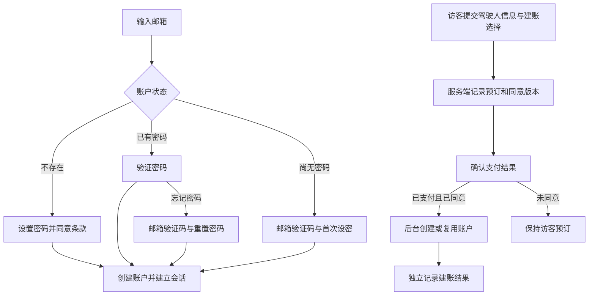

# 注册、登录与结算建账修复记录

日期：2026-10-27。参考 IX 项目的账户模块、API、结算调用及账户 SPEC；保留 TrustGo 既有认证视图和页面布局。经本次确认，驾驶人页仅挂接仓库已有的建账勾选组件，保留组件样式。

## 业务结果

| 场景 | 修复后行为 |
| --- | --- |
| 直接访问注册页 | 先用既有邮箱步骤取得有效邮箱，再进入注册；设置密码、同意当前语言有效法律版本后建账并登录，无前置验证码 |
| 统一登录入口 | 邮箱不存在进入注册；已有密码进入密码步骤；结算建账且无密码直接进入首次邮箱验证，无需先猜密码 |
| 重复注册与请求重试 | 已有账户不覆盖密码；同一表单动作复用安全随机请求号；即使请求号已知，重放仍须验证当前密码才签发会话 |
| 首次设密与忘记密码 | 验证码绑定邮箱及用途，十分钟有效、五次尝试、六十秒重发间隔；密码格式和确认错误不消耗正确验证码 |
| 修改 / 重置密码 | 撤销原有会话和挑战；成功后为当前请求签发新会话；已设置密码账户不能用“首次设密”覆盖密码 |
| 账户资料与会话 | 未鉴权响应不包含账户资料；接口 401 清除前端账户与资料；重新聚焦、恢复可见和标签页间账户变化时刷新会话 |
| 退出失败 | 保留当前账户状态，提示重试；服务端撤销成功后才清空前端状态和导航 |
| 访客预订 | 建账默认勾选，取消后不建账；选择随同条款版本记录到可信服务端预订，浏览器仅保存非敏感选择 |
| 结算建账 | 支付确认后，服务端用已授权预订的邮箱创建或复用账户；失败不改变支付结果，可安全重试；不自动登录、不披露已有账户、不修改营销订阅 |
| 已登录预订 | 不展示建账勾选，不创建其他账户；不凭联系邮箱相同自动关联全部历史订单 |

本次以 IX SPEC 最新变更中“支付完成后按预留选择建账”的规则处理触发时点；IX 当前页面代码较早发起建账的行为未直接复制。

## 生产服务边界

真实账户持久化和邮件投递仍是外部依赖，未在本次虚构实现。IX 参考项目也只有内存账户存储与通知元数据。

- 本地开发 / 测试可完成业务回归，重启仍会清空内存账户与会话，通知状态明确为 `preview_only`。
- 当前生产构建的账户接口返回 `503 SERVICE_UNAVAILABLE`，退出可继续清理 Cookie；生产租车仍按自身 adapter 配置判断可用性。若本地租车适配器被显式用于生产，支付与账户结果仍保持独立。
- 这解决了“生产静默使用内存并报告注册 / 发信成功”的问题，**不代表已接入真实持久化或邮件服务**。上线须以真实账户服务替换本地适配器，并完成共享会话、事务、唯一性、限流、审计和安全邮件投递联调。
- 账户写接口统一验证同源、JSON 和输入范围；反向代理须覆盖不可信的转发来源头。密码登录按来源与规范化邮箱限流，验证码身份键与账户索引一致，随机数使用安全随机源。

## 验证

| 检查 | 结果 |
| --- | --- |
| `npm run test:customer-account` | 31 项账户回归：真实 Route Handler / Store 调用，隔离 Cookie 请求上下文与合成数据，不访问网络 |
| `npm run test:rental-business` | 32 项租车场景，覆盖支付、取消、订单归属与接口权限 |
| `npm run check:i18n` | 五语言资源检查；新增退出失败文案使用统一资源 |
| `npm run build` | 生产构建、类型检查；既存 ESLint 警告另见构建输出 |
| 浏览器交互 | 未代替人工验收，以下项目均待确认 |

## 人工验收清单

通过 `npm run preview` 启动或复用本项目开发服务；基础地址为 `http://localhost:4000`。语言分别覆盖 `en`、`zh`、`ja`、`es`、`ko`，视口至少覆盖桌面 1440×900 与手机 390×844。下列结果均为预期，尚未经人点击确认。

| 页面 / URL | 操作 | 预期 |
| --- | --- | --- |
| `/{lang}/account/register` | 直接打开，填写新邮箱、密码与确认密码后注册；取消同意再提交 | 先取得邮箱；取消同意不建账，合法提交后进入账户页并显示已登录 |
| `/{lang}/account/sign-in` 与导航弹窗 | 已有密码邮箱继续，分别提交错误与正确密码 | 进入密码视图；错误可恢复，正确才登录；弹窗保持当前页面，独立页进入账户页 |
| 同上 | 结算建账的新邮箱继续；使用开发响应辅助完成验证码和首次设密 | 直接进入验证码视图；设密后可用邮箱与密码登录，不影响预订状态 |
| 同上 | 忘记密码；输入错误 / 过期验证码；重发；修正不合规新密码 | 不同用途不可混用；重发后旧码失效；密码格式错误可继续使用正确验证码；成功后旧密码和旧会话失效 |
| 导航认证弹窗 | 输入密码或验证码后关闭重开；提交中尝试切换步骤 | 重开不恢复秘密字段；提交中禁止重复动作；已关闭表单的迟到结果不关闭新弹窗 |
| `/{lang}/rent` → 费率详情 → `/{lang}/book/driver?rateDetailsId=…` | 访客保留或取消建账勾选，查看条款链接；已登录再进入 | 默认勾选，链接不切换选择；已登录不展示建账块；原有表单布局与组件样式保留 |
| `/{lang}/checkout/{reservationId}` → `/{lang}/booking/{confirmationCode}` | 完成支付后查询账户状态；重复确认支付；账户服务失败后重试 | 已同意才建账；支付保持成功；账户不重复、通知不重复、不自动登录；服务失败单独记录 |
| `/{lang}/account` | 在另一标签页退出，返回当前页；过期后继续操作；退出时模拟断网 | 清除过期账户资料；退出网络失败保留当前状态并提示重试；成功退出后刷新不恢复登录 |

账户服务失败对支付的隔离、请求重放、验证码消费顺序和旧会话撤销已通过自动回归注入验证；真实邮件到达率、持久化、多实例及真实 FE / 支付联调仍未验收。
