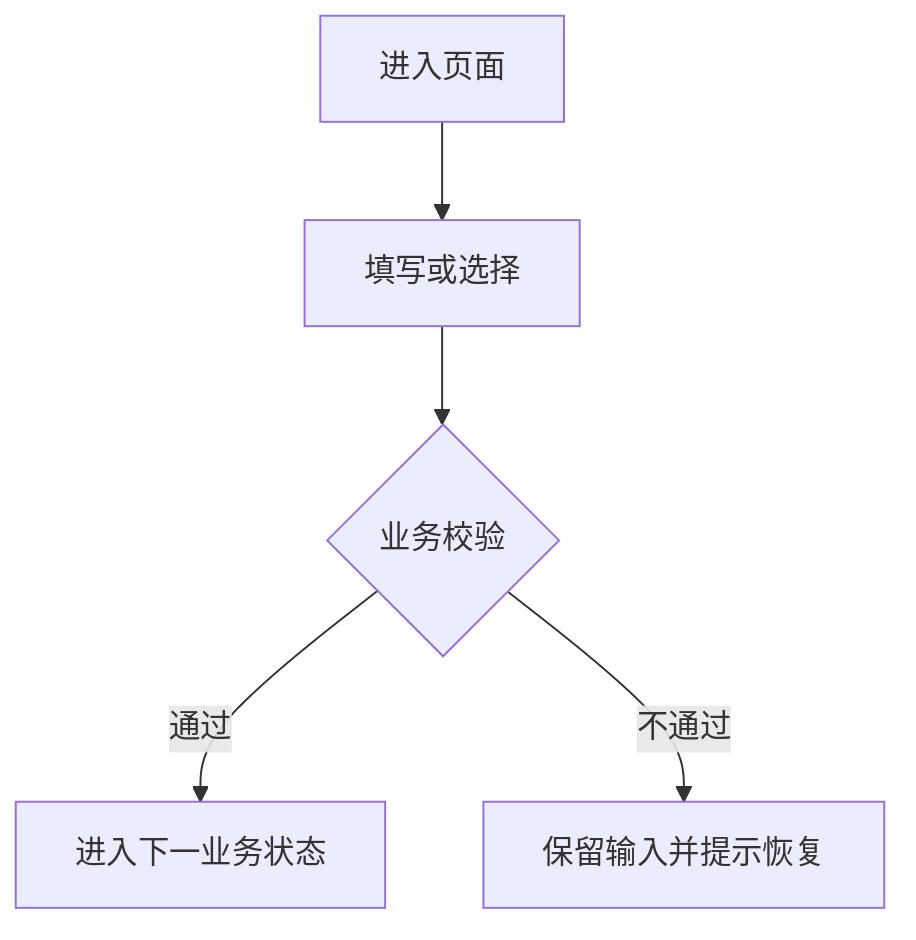

# TrustGo PRD / SPEC 需求文档模板

> 本模板只写具体业务需求。项目公共规则默认继承根目录 `AGENTS.md`，不在每份文档重复；只有某个页面存在专项要求时，才写入对应页面需求和验收标准。

## 文档信息

| 文档版本 | 文档状态 | 最后更新 | 负责人 |
| --- | --- | --- | --- |
| v1.0 | 草稿 / 已确认 / 已废弃 | YYYY-MM-DD | [姓名或团队] |

## 1. 背景与目标

### 1.1 背景与问题

[说明用户现在遇到什么问题、问题发生在哪个流程、造成什么业务影响。]

### 1.2 目标

| ID | 目标 | 验收方式 |
| --- | --- | --- |
| G-001 | [要实现的业务结果] | [用户完成什么动作或达到什么结果即通过] |

### 1.3 非目标

- [本需求明确不处理的业务范围]

## 2. 用户与核心场景

### 2.1 用户任务

| 用户 | 要完成的任务 | 前置条件 | 成功结果 |
| --- | --- | --- | --- |
| [用户] | [任务] | [条件] | [结果] |

### 2.2 术语与业务对象

| 术语 | 定义 | 容易混淆的对象 |
| --- | --- | --- |
| [术语] | [面向业务的定义] | [明确不是什么] |

### 2.3 核心场景

| 场景 ID | 用户输入 / 触发 | 系统处理 | 用户结果 |
| --- | --- | --- | --- |
| SC-001 | [触发] | [处理] | [结果] |

## 3. 页面与流程需求

> 每个受影响页面单独写一节，直接定义该页面的 PC 与 H5 表现。没有独立的“PC 与 H5”总章。

### 3.1 [页面名称]

**页面目标**：[用户在这个页面完成什么]

**进入条件**：[从哪里进入、需要什么前置状态]

| 页面区域 / 字段 | 内容与业务规则 | PC | H5 mobile | 异常与恢复 |
| --- | --- | --- | --- | --- |
| [区域或字段] | [显示内容、交互、校验、状态变化] | [桌面布局与操作] | [移动布局、触控、软键盘与安全区域] | [错误、空状态、重试及保留内容] |

**页面动作**：

| 动作 | 出现条件 | 点击后处理 | 成功结果 | 失败结果 |
| --- | --- | --- | --- | --- |
| [CTA] | [条件] | [处理] | [结果] | [提示与恢复] |

**页面专项规则**：

- [仅写这个页面特有的 i18n、SEO、可访问性或性能要求]

### 3.2 [下一页面名称]

[按 3.1 的结构继续填写。]

### 3.3 端到端流程

1. [主流程步骤]
2. [业务判断和状态变化]
3. [完成结果]

## 4. 业务规则与校验

### 4.1 业务规则

| 规则 ID | 触发条件 | 系统处理 | 用户看到的结果 |
| --- | --- | --- | --- |
| BR-001 | [条件] | [处理] | [结果] |

### 4.2 字段规则

| 字段 | 类型 | 必填条件 | 默认值 | 校验规则 | 错误提示与恢复 |
| --- | --- | --- | --- | --- | --- |
| [字段] | [类型] | [条件] | [默认值] | [规则] | [具体处理] |

### 4.3 状态与异常

| 状态 / 异常 | 进入条件 | 页面表现 | 可执行动作 | 结束条件 |
| --- | --- | --- | --- | --- |
| [状态] | [条件] | [表现] | [动作] | [条件] |

复杂状态变化需补充状态机，不得用一个 `loading / error` 代替业务含义不同的阶段。

## 5. 数据对象与字段（按需）

> 只有字段含义、来源或计算规则会影响业务和页面实现时才写本章；不在 PRD 中设计数据库表。

| 对象 / 字段 | 业务含义 | 取值或计算规则 | 使用页面 |
| --- | --- | --- | --- |
| [对象或字段] | [含义] | [明确规则] | [页面] |

## 6. 埋点与指标（按需）

| 事件 / 指标 | 触发或定义 | 属性 | 目标 |
| --- | --- | --- | --- |
| [事件或指标] | [定义] | [字段] | [目标] |

## 7. 验收标准

验收按具体页面和业务场景编写，PC 与 H5 mobile 在同一条验收中说明，不另设响应式总章。

| AC ID | 页面 / 场景 | 操作 | PC 通过标准 | H5 mobile 通过标准 |
| --- | --- | --- | --- | --- |
| AC-[DOMAIN]-001 | [页面或场景] | [操作] | [可观察结果] | [可观察结果] |

至少覆盖主流程、字段校验、无结果、接口失败、重复提交、状态恢复和受影响的既有租车链路。

## 8. 依赖与责任

| 依赖 | 已确定的规则或交付物 | 责任方 | 未满足时的处理 |
| --- | --- | --- | --- |
| [依赖] | [已经确定的具体要求] | [团队 / 角色] | [阻断 / 不展示 / 降级] |

## 9. 附件（按需）

- [复杂数据研究、许可或样本证据]
- [详细领域模型和技术契约]

## 10. 多语言、术语与格式化（按需）

> 本章用于需要用户可见文案、语言路由、租车术语、货币或日期时间展示的需求。参考翻译是内容评审的起点，不是机器翻译结果，也不替代目标语言母语审校。若本需求不新增文案或格式化规则，可明确写“不适用”。

### 10.1 Type 1–5 数据分类

先判断数据类型，再决定是否翻译、是否保存双语字段或如何格式化。不要把 Type 2 业务事实误当成 Type 1 文案，也不要把 Type 4 法律文本按普通 UI 文案回退。

| 类型 | 官网常见数据 | 处理策略 | 例子 |
| --- | --- | --- | --- |
| Type 1 系统预设 | 导航、按钮、状态、地点类型、车型筛选项、错误与空状态 | 通过 `resource_key` 使用已审核语言资源；同一语义只保留一个 key | `Pickup location`、`Booking processing` |
| Type 2 业务数据 | 预订编号、订单号、车牌号、客户姓名、备注、自由文本 | 保留业务原值，不翻译、不音译、不用另一语言改写；按权限脱敏 | `IXR-240001`、车牌号 |
| Type 3 核心双语对象 | 門店/地點、車型組/具體車型、保障方案、附加服務 | 使用業務主資料中的本地名稱與英文兜底；缺失時顯式暴露治理缺口 | 門店名稱、車型名稱 |
| Type 4 法律与规则文本 | 租赁条款、隐私政策、取消/退款规则、证件要求 | 按语言维护审核版本、适用市场和生效时间；缺版本时按页面规则阻断或降级 | `Terms of Service` |
| Type 5 格式化数据 | 日期、时间、时区、金额、税费、距离、油量/电量 | 保留原始值、币种和时区，由页面或导出层按 Locale 格式化 | `31/12/2026`、`JPY 10,000` |

### 10.2 `resource_key` 命名建议

- 命名格式：`{domain}.{module}.{scope}.{name}`，全部使用小写字母、数字、`.` 和 `_`。
- 同一业务语义只使用一个 key；不要以语言、页面视觉位置或临时文案作为 key 名。
- 动作、状态、错误、提示和 SEO 文案按作用域命名，例如 `booking.action.confirm`、`booking.status.processing`、`booking.error.payment_failed`。
- 带变量的文案必须在表中列出占位符（如 `{time}`、`{store}`），各语言保留同一变量名，不把个人数据放入 URL 或 key。
- 本表中的 key 是需求建议；实现时必须映射到当前 i18n 入口，并在缺失翻译检查中可检测。

### 10.3 官网参考翻译（审校起点）

当前官网路由语言为 `en`、`zh`、`ja`、`es`、`ko`，其中 `zh` 使用繁體中文。下表用于统一高频租车术语和 key 方向；具体页面需结合上下文、市场和法务版本确认，不得直接把参考表当作已发布文案。

| 中文（繁體） | English | 日本語 | Español | 한국어 | `resource_key` |
| --- | --- | --- | --- | --- | --- |
| 首頁 | Home | ホーム | Inicio | 홈 | `site.nav.home` |
| 車型 | Vehicles | 車両 | Vehículos | 차량 | `site.nav.vehicles` |
| 門店與地點 | Locations | 店舗・場所 | Ubicaciones | 지점 및 위치 | `site.nav.locations` |
| 取車 | Pickup | 受け取り | Recogida | 픽업 | `rental.trip.pickup` |
| 還車 | Return | 返却 | Devolución | 반납 | `rental.trip.return` |
| 取車地點 | Pickup location | 受け取り場所 | Lugar de recogida | 픽업 장소 | `rental.search.pickup_location` |
| 還車地點 | Return location | 返却場所 | Lugar de devolución | 반납 장소 | `rental.search.return_location` |
| 車型組 | Vehicle group | 車両グループ | Grupo de vehículos | 차량 그룹 | `vehicle.group` |
| 具體車型 | Specific model | 車種 | Modelo específico | 특정 차종 | `vehicle.specific_model` |
| 預訂編號 | Booking reference | 予約番号 | Referencia de reserva | 예약 번호 | `booking.reference` |
| 訂單詳情 | Booking details | 予約詳細 | Detalles de la reserva | 예약 상세 | `booking.details` |
| 預計總額 | Estimated total | 見積もり合計 | Total estimado | 예상 총액 | `pricing.estimated_total` |
| 今日支付 | Due today | 本日の支払額 | Importe a pagar hoy | 오늘 결제 금액 | `pricing.due_today` |
| 取車支付 | Pay at pickup | 受け取り時の支払い | Pago en la recogida | 픽업 시 결제 | `pricing.pay_at_pickup` |
| 押金 | Deposit | デポジット | Depósito | 보증금 | `pricing.deposit` |
| 保障 | Protection | 補償 | Protección | 보장 | `rental.protection` |
| 附加服務 | Add-ons | 追加オプション | Extras | 추가 옵션 | `rental.add_ons` |
| 取消 | Cancellation | キャンセル | Cancelación | 취소 | `booking.cancellation` |
| 退款 | Refund | 返金 | Reembolso | 환불 | `booking.refund` |
| No-show | No-show | ノーショー | No presentado | 노쇼 | `booking.no_show` |
| 確認預訂 | Confirm booking | 予約を確定 | Confirmar reserva | 예약 확인 | `booking.action.confirm` |
| 訂單處理中 | Booking processing | 予約処理中 | Reserva en proceso | 예약 처리 중 | `booking.status.processing` |
| 聯繫客服 | Contact support | サポートに連絡 | Contactar con soporte | 지원팀 문의 | `support.contact` |
| 自助取車 | Self-service pickup | セルフピックアップ | Recogida autoservicio | 셀프 픽업 | `pickup.self_service` |
| 語言 | Language | 言語 | Idioma | 언어 | `site.language` |
| 貨幣 | Currency | 通貨 | Moneda | 통화 | `site.currency` |

### 10.4 本需求文案矩阵

新增或修改用户可见文案时，逐条填写下表。若某语言暂不支持，必须写明缺失处理、审校责任和上线条件，不得用 key、英文临时文案或未经审核的机器翻译替代。

| 中文（繁體） | English | 日本語 | Español | 한국어 | `resource_key` | Type | 审校/回退规则 |
| --- | --- | --- | --- | --- | --- | --- | --- |
| [繁體中文文案] | [English copy] | [日本語文案] | [Texto en español] | [한국어 문안] | `[domain.module.scope.name]` | [1/2/3/4/5] | [審核狀態、缺失時處理] |

### 10.5 多语言与格式化验收

- 五种已支持语言均无 `resource_key`、组件 key 或内部状态名裸露；同一业务状态在各语言中语义一致。
- 语言切换或语言路由变化后，页面保留合法的搜索、预订或查单状态；业务 ID、金额原值和服务端订单事实不因语言变化而改变。
- Type 2 数据保持原值；Type 3 使用已确认的本地名/英文兜底；Type 4 只展示适用且已审核的语言版本。
- 日期、时间、时区、货币、税费、距离和油量/电量按页面 Locale 与业务时区正确格式化，不能用字符串拼接替代。
- SEO 页面补齐对应语言的 `title`、description、`canonical`、`hreflang`、HTML `lang` 和图片替代文本；缺少核心语言时按页面规则隐藏、降级或 `noindex`。

## 11. 变更记录

| 日期 | 版本 | 变更 |
| --- | --- | --- |
| YYYY-MM-DD | v1.0 | 初始版本 |
